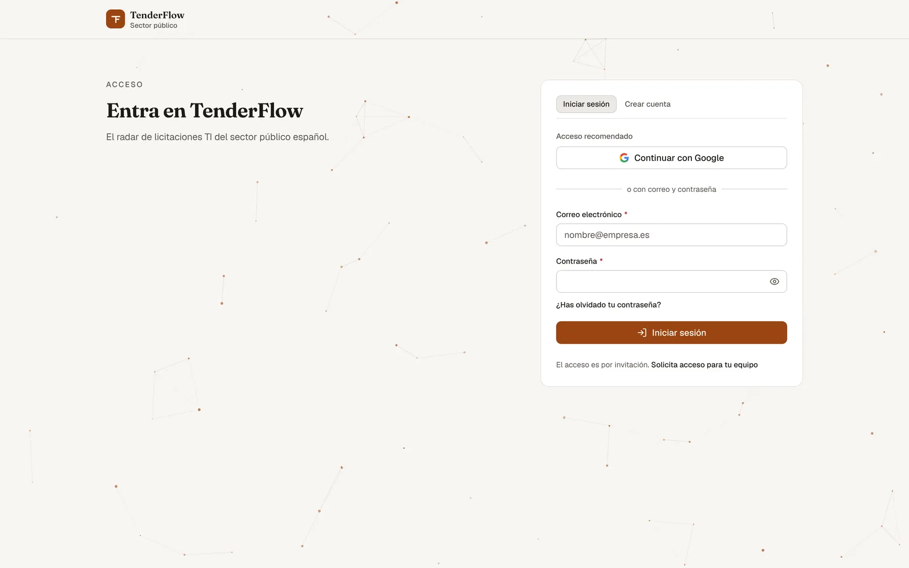
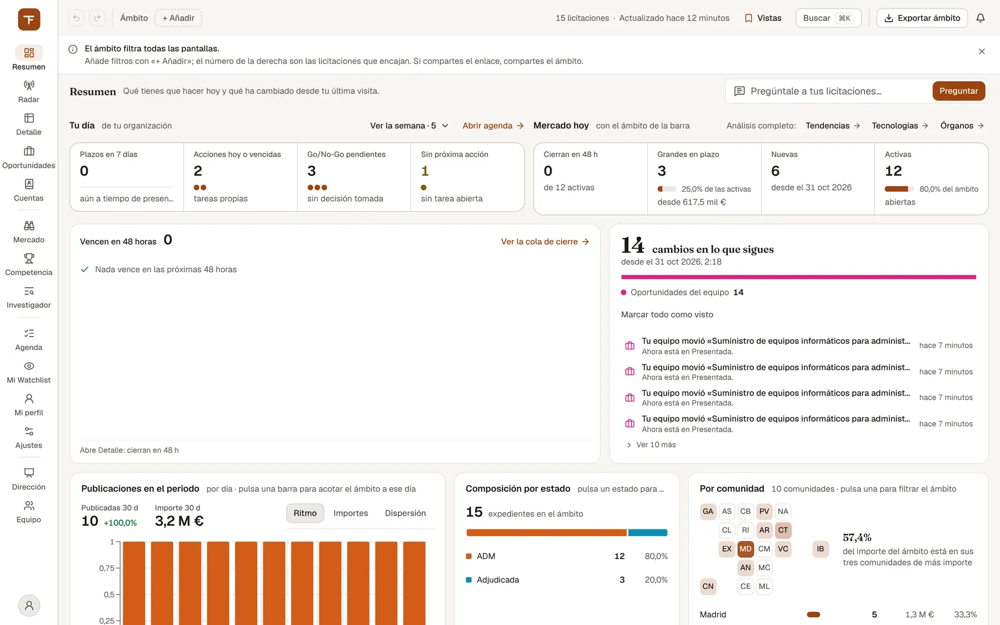
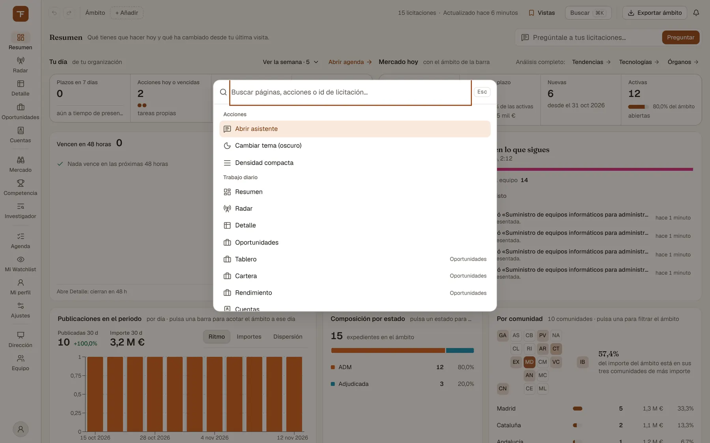
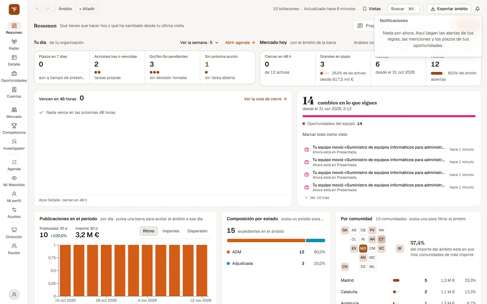

# Primeros pasos: acceso y cómo moverse por la consola

> Cómo conseguir acceso, entrar en TenderFlow y orientarte en la consola: el rail de espacios, la barra de ámbito, la búsqueda ⌘K, la ficha lateral y la campana.

## Para qué sirve y cuándo usarlo

Este capítulo es para el primer día y para las dudas de «¿dónde estaba esto?». Cubre:

- **Antes de tener cuenta:** pedir acceso, crear la cuenta y activarla.
- **Cada día:** entrar (con contraseña, Google o Microsoft si está disponible), el segundo factor si lo tienes activado y qué hacer si olvidas la contraseña.
- **Dentro de la consola:** las piezas que están en todas las pantallas y que el resto de capítulos dan por conocidas.

TenderFlow no tiene alta libre ni planes de pago: el acceso es por concesión. Se pide, una persona de la plataforma lo habilita para tu correo o para el dominio de tu empresa, y a partir de ahí te creas la cuenta.

## Qué ves en pantalla

### La puerta de entrada (`/login`)

*La puerta de entrada: pestañas «Iniciar sesión» y «Crear cuenta», acceso con Google y formulario de correo y contraseña.*

Junto al título «Entra en TenderFlow» hay un panel con, de arriba abajo:

- Dos pestañas: **«Iniciar sesión»** y **«Crear cuenta»**.
- **Acceso recomendado:** el botón «Continuar con Google» y, solo si tu instalación lo tiene configurado, «Continuar con Microsoft». Si no ves el de Microsoft, no está disponible en tu instalación. Estos botones salen en las dos pestañas.
- El separador «o con correo y contraseña» y el formulario de la pestaña elegida. En «Iniciar sesión», bajo el campo de la contraseña, está el enlace «¿Has olvidado tu contraseña?».
- Al pie de «Iniciar sesión», la nota «El acceso es por invitación. Solicita acceso para tu equipo», que lleva al formulario de la portada. En «Crear cuenta» no sale; en su lugar, justo encima del botón, se lee «Para crear la cuenta, tu correo tiene que tener el acceso concedido. ¿Aún no lo tienes? Solicítalo».

Si llegas con un enlace de invitación a un equipo, encima de los botones de acceso aparece un aviso: entra con el **mismo correo** al que se envió la invitación y te añaden al equipo al entrar. Si la invitación caducó o ya se usó, entras igualmente; solo que no te añade.

Si ya tienes la sesión abierta, la puerta no te pide nada: dice «Ya has entrado como …» y ofrece «Ir a Resumen» (o «Continuar», si venías de otra pantalla) y «Entrar con otra cuenta».

### La consola

*La consola: el rail de espacios a la izquierda, la barra de ámbito arriba y, la primera vez, el aviso que explica qué es el ámbito.*

Una vez dentro, toda pantalla tiene las mismas piezas fijas:

| Pieza | Dónde | Para qué |
| --- | --- | --- |
| **Rail de espacios** | Columna estrecha a la izquierda | Ir a cada espacio. Arriba, el logotipo lleva al Resumen; abajo, el menú de cuenta. |
| **Barra de ámbito** | Franja superior | Los filtros globales, las vistas guardadas, «Buscar», «Exportar» y la campana. |
| **Ficha lateral** | Panel a la derecha, cuando abres una licitación | Ver una licitación sin salir de la lista. |
| **Campana** | Extremo derecho de la barra | Tus avisos en la organización activa. |

**El rail.** Cada destino es un icono con su nombre debajo; al pasar el ratón sale una frase con lo que resuelve. Los espacios van en cuatro bloques separados por una línea (en la paleta ⌘K llevan nombre):

| Bloque | Espacios |
| --- | --- |
| Trabajo diario | Resumen, Radar, Detalle, Oportunidades, Cuentas |
| Análisis | Mercado, Competencia, Investigador |
| Mi seguimiento | Agenda, Mi Watchlist, Mi perfil, Ajustes |
| Organización | Dirección, Equipo, Ops y Admin |

No todo el mundo ve todos: **Dirección** solo aparece a quien es propietario o administrador de la organización activa cuando esta es un equipo (no su organización personal) y a los administradores de la plataforma; **Ops y Admin**, solo a los administradores de la plataforma. Que un espacio no salga en el rail no es el permiso en sí: la autorización real la aplica el servidor en cada petición.

Algunos espacios tienen varias **vistas** (pestañas junto al título del espacio, por ejemplo Mercado › Geografía). Cambiar de vista no cambia de página: el ámbito y lo que tengas seleccionado se mantienen. Una vista experimental lleva junto a su nombre la marca «Exp»; al pasar el ratón dice «Vista experimental: en validación, puede cambiar o desaparecer».

**La barra de ámbito.** El *ámbito* son los filtros globales que comparten las pantallas. En las pantallas que lo aplican verás, de izquierda a derecha:

- Las flechas «Deshacer cambio de ámbito» y «Rehacer cambio de ámbito».
- El rótulo **Ámbito** y un chip por filtro activo («Busca», «Periodo», «Estado», «CCAA», «Tecnología», «Importe»). Cada chip tiene su botón para quitarlo.
- **«+ Añadir»**, que abre el editor con: Búsqueda, Periodo (fechas desde/hasta y atajos «Últimos 7 días», «Últimos 30 días», «Últimos 90 días», «Este año (YTD)», «Últimos 12 meses», «Todo»), Comunidad autónoma, Tecnología, Estado (con la casilla «Sólo abiertas (sin adjudicar ni cerrar)») e Importe mínimo (atajos «> 100K», «> 500K», «> 1M» y «Cualquiera»). Con algún filtro activo, al pie aparece «Limpiar el ámbito».
- A la derecha, el **recuento** («N licitaciones» que encajan con el ámbito, calculado solo con los filtros que esa pantalla aplica) y «Actualizado hace …»: cuándo entró en TenderFlow el dato más reciente, no cuándo se ejecutó la última descarga.
- «Vistas», «Buscar ⌘K», «Exportar ámbito» y la campana. En las pantallas que no aplican el ámbito no hay «Vistas», y el botón de exportar se llama solo «Exportar».

La primera vez aparece debajo una franja que explica la barra («El ámbito filtra todas las pantallas…»); se cierra con la X y no vuelve a salir en ese navegador.

El ámbito vive en la dirección de la página: **si compartes el enlace, compartes el ámbito**, y al moverte por el rail los filtros te acompañan.

**Qué filtros aplica cada pantalla.** No todas usan el ámbito entero, y la barra lo dice siempre:

- Si la pantalla no lo usa, verás «El ámbito no aplica en esta pantalla.» (y, con filtros puestos, «El ámbito global no aplica en esta pantalla (N filtros activos).» con un botón «Limpiar»).
- Si usa solo una parte, los chips y el recuento se limitan a esa parte y aparece «N filtros activos no aplican en esta pantalla» con «Quitarlos», que retira solo los que sobran.

| Pantalla | Filtros del ámbito que aplica |
| --- | --- |
| Resumen | Todos |
| Investigador | Ninguno por defecto. Si activas «Aplicar el ámbito» en sus opciones avanzadas, solo comunidad autónoma, tecnología y fechas (la barra muestra todos los chips, pero el resto no viaja) |
| Detalle | Todos, más tres propios del listado: procedimiento, provincia e importe máximo |
| Radar | Solo Tecnología, y de una en una |
| Agenda | Tecnología y comunidad autónoma (admite varias de cada una) |
| Mercado | Según la vista (por ejemplo, Geografía usa periodo y tecnología; Renovaciones, solo tecnología) |
| Competencia | Competidores: periodo, CCAA, tecnología, estado e importe; UTEs: periodo y CCAA; Empresas: ninguno |
| Oportunidades, Mi Watchlist, Mi perfil, Ajustes, Dirección, Equipo, Ops y Admin | Ninguno |

El detalle de cada caso está en el capítulo de cada espacio.

## Cómo se hace

### Pedir acceso

1. Ve a la portada de TenderFlow y baja al formulario de solicitud (también llegas desde «Solicita acceso para tu equipo» en `/login`).
2. Rellena «Email de trabajo» (obligatorio) y, si quieres, «Empresa» y «¿Qué quieres mirar? (opcional)».
3. Marca la casilla de aceptación del tratamiento de datos (sin ella la solicitud no se registra) y pulsa «Enviar solicitud».
4. Verás «Solicitud recibida». El acceso se habilita a mano, con tu correo o con el dominio de tu empresa, así que la respuesta llega por correo y no es inmediata.

Si algo falla, la misma página te dice qué: correo no válido, casilla sin marcar, demasiados envíos desde tu conexión (espera un minuto) o un fallo del servidor. En el primer caso tendrás que volver a escribir el resto del formulario.

### Crear la cuenta y activarla

1. Cuando te concedan el acceso recibirás un correo «Ya tienes acceso a TenderFlow». Su botón «Crear mi cuenta» abre `/login` en la pestaña «Crear cuenta» con tu dirección ya puesta; si esa dirección es una cuenta de Google, también puedes entrar directamente con «Continuar con Google».
2. Escribe tu nombre (opcional), la contraseña (mínimo 10 caracteres, con mayúsculas, minúsculas y un número) y repítela en «Confirmar contraseña». Pulsa «Crear cuenta».
3. Aparece «Revisa tu correo»: te llega un enlace de activación. Hasta que no lo abras, tu contraseña no te deja entrar.
4. Abre el enlace. La página «Activa tu cuenta» muestra «Activando tu cuenta…», luego «Cuenta activada. Entrando en TenderFlow…», y te lleva directamente al Resumen.

Si no llega, mira en el correo no deseado o pulsa «Volver a enviar el enlace»; solo vale el último enviado. «Usar otro correo» te devuelve al formulario. Si al abrir el enlace ves «El enlace no es válido o ha caducado» (cada enlace sirve una vez y caduca), pulsa «Pedir otro enlace» y repite el alta con el mismo correo.

Si tu correo no tiene el acceso concedido, el alta lo dice («Este correo no tiene acceso a TenderFlow todavía.», con un botón «Solicita acceso») y no crea nada. Si te retiraron el acceso entre el alta y la activación, el enlace dice «Este correo ya no tiene acceso a TenderFlow» y la cuenta no se activa.

### Entrar con correo y contraseña

1. En `/login`, pestaña «Iniciar sesión», escribe tu «Correo electrónico» y tu «Contraseña» (el botón del ojo, «Mostrar contraseña» / «Ocultar contraseña», enseña u oculta lo que escribes).
2. Pulsa «Iniciar sesión». Entras en el Resumen o, si venías de un enlace a otra pantalla de la consola, en esa pantalla con sus filtros.

Mensajes habituales: «Credenciales incorrectas.»; «Todavía no has activado la cuenta: abre el enlace que te enviamos al correo.» con el botón «Recibir otro enlace» (te pasa a «Crear cuenta» con tu correo para que repitas el alta y te llegue un enlace nuevo); y «Tu cuenta ya no tiene acceso a TenderFlow.» con «Solicita acceso», si te retiraron el acceso (tampoco podrás entrar con Google).

### Entrar con Google o Microsoft

1. Pulsa «Continuar con Google» (o «Continuar con Microsoft», si aparece) e identifícate en la página del proveedor.
2. Vuelves a TenderFlow con la sesión abierta.

Si ese correo ya tiene cuenta con otro método, verás «Ese correo ya tiene cuenta con otro proveedor: entra con el que usaste la primera vez.». Si el correo no tiene acceso: «Tu cuenta no tiene acceso a TenderFlow.». Si tardaste demasiado en la página del proveedor: «La sesión de inicio caducó o ya se usó. Inténtalo de nuevo.».

### Entrar con la verificación en dos pasos

Si la tienes activada (se activa en Ajustes › Seguridad, ver [Ajustes](11-ajustes.md)), después de la contraseña, de Google o de Microsoft la puerta pide un segundo paso:

1. En «Código de verificación», escribe el código de seis dígitos de tu app de autenticación, o uno de tus códigos de recuperación.
2. Pulsa «Verificar».

Cada código de recuperación sirve una sola vez. Un código equivocado dice «Código incorrecto. Revisa tu app de autenticación.»; tras varios seguidos verás «Demasiados intentos fallidos. Espera unos minutos e inténtalo de nuevo.». «Cancelar y volver» cierra la sesión a medias y te devuelve al inicio.

### Restablecer la contraseña

1. En `/login`, pulsa «¿Has olvidado tu contraseña?».
2. Escribe tu correo y pulsa «Enviar enlace de recuperación». La respuesta es siempre la misma, exista o no la cuenta: «Si ese correo entra en TenderFlow con contraseña, te llegará un enlace para cambiarla.».
3. Abre el enlace del correo, escribe la «Nueva contraseña» (misma política que en el alta), confírmala y pulsa «Actualizar contraseña».
4. Con «Contraseña actualizada. Ya puedes iniciar sesión.», pulsa «Volver a iniciar sesión».

Si entras con Google o Microsoft no necesitas esto (la propia pantalla lo recuerda bajo el campo del correo).

### Usar la barra de ámbito

1. Pulsa «+ Añadir» y elige los filtros. Se aplican al momento; la búsqueda espera a que dejes de teclear.
2. Para quitar uno, pulsa la X de su chip. Para empezar de cero, «Limpiar el ámbito» en el editor.
3. Si te equivocas, usa las flechas de deshacer y rehacer.

### Guardar y recuperar una vista del ámbito

1. Con el ámbito que quieras, pulsa «Vistas» en la barra (o, en la paleta ⌘K, «Guardar vista actual»).
2. Escribe un nombre en «Nombre de la vista…» y pulsa el botón «+».
3. Para recuperarla, abre «Vistas» y pulsa su nombre: el ámbito vuelve tal cual. Para borrarla, el icono de la papelera.

Las vistas se guardan en tu cuenta, no en el navegador, y van ligadas a la organización activa. Las que guardas aquí son privadas: nadie más las ve.

### Buscar y saltar con la paleta ⌘K

*La paleta ⌘K: acciones, espacios y vistas a un atajo de distancia.*

1. Pulsa `Ctrl+K` (`⌘K` en Mac) desde cualquier sitio, o el botón «Buscar» de la barra.
2. Escribe. La paleta ofrece:
   - **Saltar a:** «Ir a licitación …» si lo escrito parece un identificador de expediente, o «Buscar «…» en licitaciones», que abre Detalle con esa búsqueda.
   - **Resultados** agrupados en Expedientes, Empresas, Órganos y Oportunidades de tu equipo (estas últimas solo con una organización activa). Si escribes un NIF exacto, abre la empresa directamente.
   - **Acciones:** «Abrir asistente», «Cambiar tema» y la densidad.
   - **Acciones con filtros** (solo si hay ámbito activo): «Guardar vista actual», «Crear regla de watchlist con estos filtros», «Exportar CSV (vista actual)», «Exportar Excel (vista actual)» y «Copiar enlace con filtros».
   - **Todos los espacios y sus vistas**, para ir directo (por ejemplo, «Geografía», de Mercado).
3. Elige con las flechas y `Intro`. `Esc` la cierra.

### Atajos de teclado

Pulsa `?` para ver la ayuda de atajos. Los generales son:

| Tecla | Hace |
| --- | --- |
| `Ctrl+K` / `⌘K` | Abrir la paleta de comandos (funciona incluso escribiendo en un campo) |
| `/` | Ir al buscador de la página, si la página tiene uno |
| `Esc` | Cerrar el panel abierto |
| `?` | Abrir la ayuda de atajos |
| `1` … `6` | Ir a Radar, Oportunidades, Resumen, Detalle, Competencia › Competidores e Investigador |

Los atajos de una sola tecla no actúan mientras escribes en un campo o estás dentro de un menú. Radar, Detalle y Agenda tienen además atajos propios de lista; están en sus capítulos.

### Abrir una licitación sin perder la lista

1. En cualquier lista de la consola (Resumen, Mi Watchlist, Competencia, Cuentas, Mercado…), pulsa una licitación: su ficha se abre en un panel a la derecha. En pantallas anchas el panel se coloca al lado y la lista se estrecha; en pantallas más pequeñas se superpone.
2. La lista sigue activa: pulsa otra licitación y el panel cambia.
3. Para la ficha a pantalla entera, pulsa el icono de ampliar de la cabecera del panel («Ficha completa, a pantalla entera»). Para cerrarlo, la X («Cerrar · Esc»), `Esc` o el botón Atrás del navegador.

Con `Ctrl`-clic (`⌘`-clic en Mac), `Mayús`-clic o el botón central del ratón, el enlace se comporta como cualquier enlace del navegador: abre Detalle con esa licitación seleccionada (por ejemplo, en otra pestaña). En Detalle y en el Radar el clic abre su propio panel de la lista, no este. Qué contiene la ficha está en [Detalle y ficha de la licitación](04-detalle-y-ficha.md).

### Revisar la campana

*La campana abierta, aquí todavía sin avisos.*

1. El número sobre la campana son tus avisos sin leer en la organización activa. Se actualiza solo cada pocos minutos.
2. Pulsa la campana: verás las notificaciones más recientes, con un punto en las no leídas. Mirar la lista no marca nada; cada aviso se marca como leído al abrirlo. «Marcar todo como leído» es una acción aparte.
3. Bajo cada aviso puede haber acciones rápidas: «Ocultar del Radar 30 días» y «Recordármelo en 7 días» (si se refiere a una licitación) y «Silenciar esta regla» (si lo disparó una regla de tu watchlist). Las tres se pueden deshacer desde el mensaje que aparece.
4. «Ver todas» abre el panel «Notificaciones» con la lista completa, filtrable por «Todas», «Sin leer» y «Leídas», y paginada con «Anteriores» y «Siguientes».

En la campana llegan las alertas de tus reglas, los cambios en lo que sigues, las menciones, las tareas y plazos de tus oportunidades y los avisos de la organización. Las novedades del mercado no están aquí: están en el [Resumen](02-resumen.md).

### Cambiar de organización, tema y densidad

Abre el **menú de cuenta** (el icono de persona al pie del rail; en móvil, arriba a la derecha):

1. **Organización activa:** el desplegable muestra cada organización con tu rol («Nombre · Propietario», «· Miembro»…). Lo que ves de oportunidades, avisos, vistas guardadas y equipo es el de la organización activa. La que eliges se recuerda en ese navegador, también después de cerrar sesión.
2. «Gestionar equipo» lleva a [Equipo](12-equipo-y-direccion.md).
3. «Densidad compacta» / «Densidad cómoda» ajusta cuánto cabe en las tablas.
4. «Modo oscuro» / «Modo claro» cambia el tema. Hasta que eliges uno, sigue el del sistema.
5. «Cerrar sesión» sale y te devuelve a `/login`.

### Tus primeros pasos dentro

Mientras a tu organización le quede alguno por hacer (lo normal en una organización recién creada), el Resumen muestra la banda **«Primeros pasos»** con tres tareas, cada una con lo que ganas y un enlace a donde se hace. Con las tres pendientes (y ninguna «sin comprobar») la banda sale arriba del todo; en cuanto hay una hecha o sin comprobar, baja al pie del Resumen.

1. **Completa la capacidad de tu organización** (NIF, certificaciones y facturación): sin ellos, el checklist de cada pliego contesta «desconocido». Se hace en Equipo › Organización.
2. **Revisa tu alerta**, en Mi Watchlist: ajusta qué busca y cada cuánto te avisa.
3. **Abre tu primera oportunidad**, eligiendo una licitación en el Radar.

Cada paso se marca «hecho» solo, con lo que ya consta en el servidor; lo que no se puede comprobar dice «sin comprobar», nunca «pendiente». Si no gestionas la organización, el paso de capacidad no puede salirte como hecho, porque no tienes permiso para leer sus NIF. El rótulo de la banda dice cuántos llevas («1 de 3 hechos», y «· N sin comprobar» si hay alguno sin comprobar). Con los tres hechos la banda desaparece; también puedes quitarla con su botón «Ocultar» (se recuerda en ese navegador).

## Uso en el móvil

En pantallas estrechas el rail se pliega: arriba quedan el botón «Abrir navegación» (abre el cajón «Espacios» con los mismos bloques), el logotipo y el menú de cuenta. La barra de ámbito sigue debajo y se desplaza en horizontal si no cabe; la franja de primer uso y los rótulos de atajos de teclado no se muestran.

El móvil está pensado para consultar y hacer triaje (Radar, ficha, Mi Watchlist, Agenda). El análisis con tablas grandes es de escritorio: en el móvil esas tablas se desplazan en horizontal dentro de su caja.

## Quién puede usarlo

- **Entrar y moverse por la consola:** cualquier persona con acceso concedido.
- **Roles dentro de una organización:** Propietario, Administrador, Miembro y Solo lectura. Quien tiene «Solo lectura» ve pero no modifica; un Miembro puede trabajar las oportunidades; Propietario y Administrador gestionan además los miembros, las invitaciones y la configuración de la organización (solo el Propietario da el rol Administrador; la propiedad no se asigna como rol, se traspasa), y ven Dirección. Cada persona tiene también una organización personal.
- **Administrador de la plataforma:** ve Ops y Admin, donde, entre otras cosas, se atienden las solicitudes de acceso.

El detalle de roles está en [Equipo y Dirección](12-equipo-y-direccion.md).

## Límites y avisos

- **No hay alta libre:** sin acceso concedido para tu correo o tu dominio no puedes crear cuenta, tampoco con Google.
- **Microsoft** solo aparece si tu instalación lo tiene configurado.
- **Verificación en dos pasos:** si pierdes la app y no te quedan códigos de recuperación, la pantalla de entrada no ofrece otra salida.
- **El recuento de la barra** cuenta licitaciones con los filtros que la pantalla aplica; no es el contenido de la pantalla ni una previsión.
- **«Exportar ámbito»** descarga en CSV o Excel las licitaciones que cumplen el ámbito (hasta 10.000 filas por descarga), no la tabla que estés viendo. Varias pantallas tienen su propio botón de exportación con su corte.
- **«Actualizado hace …»** dice cuándo entró el último dato. Los anuncios oficiales se recogen cada pocas horas, así que la consola no es tiempo real; si dice «Sin actualizaciones registradas», no hay fecha que mostrar.
- Si la conexión con el servidor tarda (por ejemplo, tras un rato sin usar la consola), arriba aparece «Reconectando…»: suele resolverse en unos segundos.
- TenderFlow ordena y explica licitaciones, pero **no calcula probabilidad de ganar** ninguna. Cada cifra de la consola dice de dónde sale, y la fuente oficial está siempre a un enlace.

## Relacionado

- [Resumen](02-resumen.md): la pantalla a la que llegas al entrar.
- [Radar y Mi perfil](03-radar-y-perfil.md): la bandeja priorizada de cada mañana.
- [Detalle y ficha de la licitación](04-detalle-y-ficha.md): el listado completo y la ficha.
- [Agenda y Mi Watchlist](06-agenda-y-watchlist.md): reglas de alerta y plazos.
- [Ajustes](11-ajustes.md): sesiones, verificación en dos pasos, claves y avisos.
- [Equipo y Dirección](12-equipo-y-direccion.md): roles, invitaciones y organización.
- [Ops y Admin](13-ops-y-admin.md): solicitudes de acceso (administradores de la plataforma).
- [Glosario](15-glosario.md).
