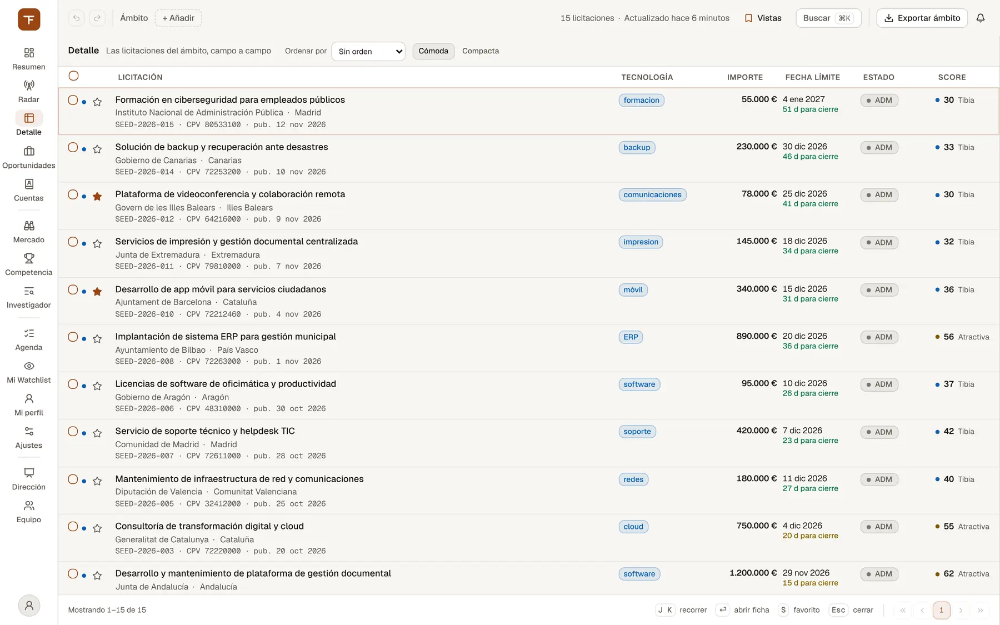
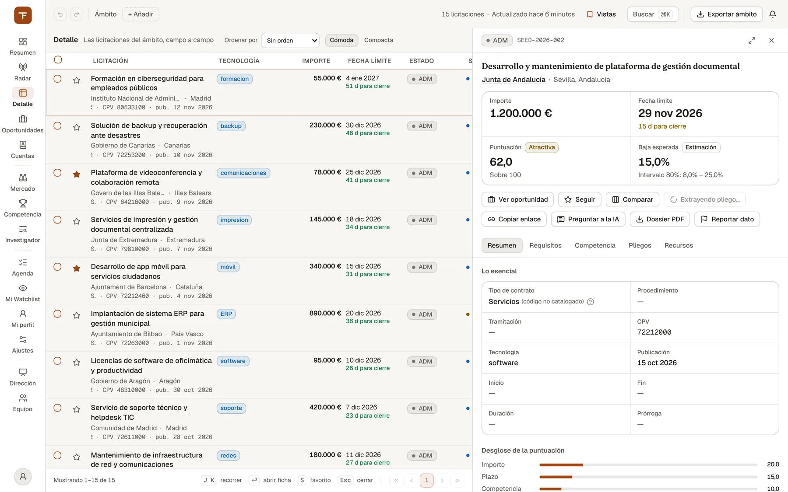

# Detalle y ficha de la licitación

> El listado completo de licitaciones del ámbito, campo a campo, y la ficha de cada expediente: qué es, qué pide, contra quién y qué le ha pasado.

## Para qué sirve y cuándo usarlo

**Detalle** (`/detalle`, tecla `4`) es la tabla de trabajo con todas las licitaciones que encajan con tu ámbito, no solo las mejor puntuadas. Se usa cuando ya sabes qué buscas: un expediente concreto, todo lo de un órgano o una provincia, lo que cierra en una ventana de fechas, o un listado para llevarte a Excel.

La **ficha de la licitación** es el mismo contenido en todas partes: en el panel lateral de Detalle, en el panel que se abre desde cualquier otra lista de la consola y en la ficha completa a pantalla entera. La usan:

- el comercial o el preventa, para leer un expediente y su pliego;
- quien evalúa si la organización se presenta, antes de abrir la oportunidad;
- quien sigue un contrato vigente, para ver lo que ha acabado costando.

TenderFlow solo recoge contratos tecnológicos: Detalle es el listado de ese radar, no un censo de toda la contratación pública.

## Qué ves en pantalla

### La tabla

*Detalle: todas las licitaciones del ámbito, campo a campo.*

Arriba, la barra de la tabla: «Detalle — Las licitaciones del ámbito, campo a campo», los recortes activos (cada uno con su «×» para quitarlo), «Ordenar por», el filtro de etiqueta y la densidad («Cómoda» / «Compacta»).

| Columna | Qué muestra |
| --- | --- |
| (casilla) | Selección para comparar, exportar o seguir en bloque. |
| (marcas) | Un punto azul si se publicó desde tu última visita, y la estrella de favorito («Añadir a favoritos» / «Quitar de favoritos»). |
| Licitación | Tres líneas: el título; el órgano, la comunidad autónoma y el procedimiento; el número de expediente, el CPV y la fecha de publicación («pub. …»). |
| Tecnología | La tecnología detectada. Si la etiqueta tiene el borde discontinuo es una «Tecnología estimada» por el clasificador, no una coincidencia del diccionario. |
| Importe | El importe publicado (abreviado en densidad compacta). |
| Fecha límite | La fecha de cierre y, debajo, cuánto queda, en color por urgencia. «Sin fecha» si la fuente no la publica. |
| Estado | El estado del expediente (publicada, en evaluación, adjudicada…). |
| Score | La puntuación de 0 a 100 y su banda (Caliente, Atractiva, Tibia, Descarte), calculada con el perfil de tu organización activa. Es la misma del Radar: mide cuánto encaja contigo, **no es una probabilidad de ganar**. |

La comunidad autónoma y la tecnología de cada fila son botones: al pulsarlos se añaden al ámbito («Filtrar por …»), y al volver a pulsarlos se quitan.

Al pie: «Mostrando 26–50 de 1.204», los atajos de teclado (en pantallas anchas) y la paginación (25 filas por página). Si aparece la etiqueta **«Orden sobre esta página»**, el orden que has elegido solo reordena las 25 filas que ves, no el total: solo Título, Importe y Publicación se ordenan sobre todas las licitaciones.

### La ficha en el panel lateral

*La ficha en el panel lateral, sin salir del listado.*

Al pulsar una fila se abre su ficha. Dónde aparece depende del ancho de la pantalla: al lado de la tabla en pantallas muy anchas, como panel superpuesto en pantallas medianas, y a pantalla entera (la ficha completa) en el móvil.

En la barra fija de arriba: el **estado**, el aviso de recurrida si consta un recurso y el número de expediente, junto a los botones «Abrir la ficha completa» y «Cerrar ficha» (también con `Esc`).

Debajo, antes de las pestañas (se desplaza con el resto de la ficha; las pestañas se quedan pegadas arriba):

- **Título** y **órgano de contratación**, que enlaza a su perfil en Mercado › Órganos, con provincia y comunidad.
- **Cifras**: «Importe» (con su base —sin IVA o con IVA—, el importe con IVA si la fuente lo publica y la duración de la ejecución), «Fecha límite» con los días que quedan, «Puntuación» sobre 100 con su banda, y «Baja esperada» (o «Baja real» si ya está adjudicada). «Ofertas esperadas» sale siempre en la ficha completa; en el panel, solo cuando no hay puntuación.
- Los **avisos de la puntuación**, si los hay.
- **«Cómo se adjudica»**: el reparto de los criterios en una barra, cuando el anuncio publica sus pesos sobre 100.
- Las **acciones** (ver «Cómo se hace»).

Debajo, cinco pestañas:

| Pestaña | Contenido |
| --- | --- |
| Resumen | «Lo esencial» (tipo de contrato, procedimiento, tramitación, CPV, tecnología, publicación, inicio, fin, duración, prórroga) y el enlace al portal de origen con «Actualizado en la fuente el …»; «Adjudicación»; «Desglose de la puntuación» (si la ficha tiene puntuación); «Descripción» («Leer completa» si es larga); «Tecnologías»; «Modificaciones del contrato»; «Eventos». |
| Requisitos | «Lotes» y la «Publicación oficial (PLACSP)»: criterios de adjudicación, garantías y solvencia tal como los publica el anuncio, y las condiciones a revisar. |
| Competencia | El bloque del acuerdo marco o sistema dinámico (solo si lo es), «Competencia esperada», «Baja esperada», «Simulador de puntuación del precio» y «Expedientes parecidos». |
| Pliegos | «Documentos», la «Ficha estructurada del pliego» con sus citas y el «Guion de la oferta técnica». |
| Recursos | Las resoluciones del TACRC; el número de la pestaña dice cuántas hay. |

### La ficha completa

Con «Abrir la ficha completa» (el icono de ampliar del panel) la ficha ocupa el sitio de la tabla y enseña todo a la vez. Arriba, «Volver a la tabla», la posición («3 de 25 en esta página») y las flechas «Licitación anterior» / «Licitación siguiente».

Además de lo del panel, la ficha completa tiene lo que el panel no:

- **«Ha cambiado desde tu última visita»**: si ya la habías abierto, una franja con lo que cambió desde entonces (plazo, importe, estado, documentos nuevos, recursos); cada cambio salta a la sección donde se ve. La primera vez, o sin cambios, no aparece.
- **«¿Cumples lo que piden?»** en Requisitos.
- **«Tu historial aquí»** en Competencia.
- En Expediente, el **calendario del expediente** (publicación, fecha límite, inicio y fin en una línea) y, entre los campos, comunidad autónoma, provincia y valor estimado.

El «Desglose de la puntuación», que en el panel está en Resumen, aquí abre la sección Competencia.

Un índice pegado arriba salta a las cinco secciones: «Expediente», «Requisitos», «Pliegos», «Competencia» e «Historia» (modificaciones, eventos y recursos). En el móvil, el enlace al portal de origen queda en una barra fija al pie.

### Qué significa cada bloque

- **Adjudicación.** Quién ganó, lote a lote cuando hay lotes: nombre, NIF, importe adjudicado, número de ofertas recibidas y fecha. Lo que la fuente no publicó se dice («importe no publicado», «ofertas no publicadas»). Si consta como adjudicada pero la fuente no dice a quién: «La fuente no ha publicado el adjudicatario».
- **Competencia esperada.** «Cuántos se presentarán» (estimación con la media del segmento, el porcentaje con oferta única y cuántos expedientes la sostienen, en los últimos meses que indica); «Quién lo tiene hoy»: el incumbente, que ganó el contrato anterior de ese órgano con el mismo objeto, con fecha, importe y baja, y el enlace «Ver el contrato anterior»; «Contra quién»: las empresas que ganan en el segmento, con su cuota sobre lo adjudicado (marcadas «Incumbente» o «Vigilada» cuando aplica); y «Cómo se puja»: la baja típica del ganador y la de la oferta mínima. Cada parte dice sobre qué segmento y cuántos expedientes se calcula; sin muestra, lo dice en vez de enseñar un cero.
- **Baja esperada.** Una estimación (rotulada «Estimación») con su intervalo del 80 %. Cuando el expediente ya está adjudicado se muestra la baja real.
- **Expedientes parecidos.** Otros expedientes del mismo CPV, de cualquier órgano. El pie dice cuántos se evaluaron y cómo se ordenaron («palabras en común» o «parecido de significado»).
- **Modificaciones del contrato** (CU-38). Las modificaciones que el órgano publicó, de la más antigua a la más reciente: fecha, motivo, lo que añaden en importe y plazo, el importe tras cada una y su fuente (PLACSP o el aviso de TED, con «Ver el aviso»). Por lote, «Tras modificaciones» compara lo adjudicado con el importe final y da la variación, solo cuando las dos cifras están publicadas y sin IVA. Al final, **«Cuánto amplía este órgano sus contratos»**: la mediana de esa variación entre sus contratos modificados, con su N. Por debajo de la muestra mínima verás «Sin datos suficientes» y cuántos contratos hay. Lo que la fuente no publica sale como «fecha no publicada» o «Motivo no publicado». Un aviso de modificación de TED se cuelga del expediente que modifica solo cuando se sabe cuál es, nunca por parecido de título, y no aparece como una licitación más en los listados.
- **Acuerdo marco / sistema dinámico** (CU-36). Ver «Leer un acuerdo marco o un sistema dinámico».

## Cómo se hace

### Buscar un expediente y acotar el listado

1. Abre Detalle desde el rail o con la tecla `4`.
2. Pulsa «+ Añadir» en la barra de ámbito. Además de los filtros comunes (Búsqueda, Periodo, Comunidad autónoma, Tecnología, Estado, Importe mínimo), Detalle es la única pantalla que aplica tres más:
   - **Procedimiento**: elige uno o varios en «Añadir procedimiento…».
   - **Provincia**: escríbela tal como la publica la fuente y pulsa Intro. También se añade pulsando una provincia en Mercado › Geografía.
   - **Importe máximo**: un número en euros; aparece como chip «Importe < …».
3. Para acotar por una **etiqueta** de tu organización, usa el selector de la barra de la tabla («Todas las etiquetas» por defecto). Filtra sobre el listado entero: el total y las páginas son los del conjunto etiquetado. El selector solo aparece si tu organización tiene etiquetas; se aplican a las licitaciones desde Mi Watchlist.
4. Si llegas desde la tarjeta de cierres del Resumen, la tabla trae un recorte por fecha de cierre («Cierra … → …»). Quítalo con su «×».

Si nada encaja verás «Sin resultados» y el botón «Limpiar ámbito» (o «Limpiar ámbito y recorte»).

Responsable y plazo de presentación no son filtros de Detalle: se filtran en el tablero de [Oportunidades](05-oportunidades.md).

### Ordenar

Elige en «Ordenar por» (Publicación, Fecha límite, Importe, Score, Título, Órgano, Estado, Procedimiento, CCAA, CPV, Tecnología, Expediente) o pulsa la cabecera de una columna. El botón de flechas invierte el orden, y el chip del orden lo quita.

### Recorrer y abrir con el teclado

| Tecla | En la tabla | En la ficha completa |
| --- | --- | --- |
| `J` / `↓`, `K` / `↑` | Mover el cursor | Solo `J` / `K`: licitación siguiente / anterior de la página (las flechas desplazan la ficha) |
| `⏎` | Abrir la ficha de la fila | — |
| `S` | Seguir o dejar de seguir | Seguir o dejar de seguir |
| `Esc` | Cerrar la ficha | Volver |

### Guardar el ámbito como vista

En «Vistas» de la barra de ámbito, escribe un nombre y pulsa Intro o el botón «+» («Guardar vista actual»). Guarda también procedimiento, provincia e importe máximo. **No** guarda el filtro de etiqueta, el orden ni el recorte por fecha de cierre. El detalle está en [Primeros pasos](01-primeros-pasos.md).

### Exportar a Excel o CSV

1. Pulsa «Exportar ámbito» en la barra de ámbito y elige «Exportar CSV» o «Exportar Excel».
2. La descarga la prepara el servidor con todos los filtros del ámbito y el recorte por fecha de cierre, si lo hay. No aplica el filtro de etiqueta. Cada descarga trae como máximo 10.000 filas.

Para exportar solo unas filas, márcalas y pulsa «Exportar selección»: descarga un CSV con las filas marcadas.

### Trabajar con varias filas a la vez

Al marcar filas aparece una barra flotante («N seleccionadas»):

- **«Comparar (N)»**: con 2 o 3 filas, las pone una al lado de otra con los campos de su ficha.
- **«Exportar selección»**: CSV de las filas marcadas.
- **«Seguir»**: las sigue todas.
- La «×» limpia la selección.

### Compartir o abrir una ficha

- «Copiar enlace» en la ficha copia su enlace permanente (`/detalle?lic=…`). Quien lo abra llega a la tabla con esa ficha abierta.
- Desde cualquier otra lista de la consola, pulsar una licitación abre la ficha en un panel sin salir de la pantalla. Ver [Primeros pasos](01-primeros-pasos.md).
- Un enlace a un expediente que no existe no rompe la pantalla: verás un aviso de error y la tabla sigue funcionando.

### Seguir y anotar una licitación

Pulsa «Seguir» en la ficha (o la estrella de la fila, o `S`). Pasa a «Siguiendo» y aparece en tu Mi Watchlist, que es donde se añaden notas y etiquetas: ver [Agenda y watchlist](06-agenda-y-watchlist.md).

### Leer el pliego con la cita delante (CU-22)

1. Abre la pestaña **Pliegos** (o la sección Pliegos de la ficha completa).
2. Si no hay ficha del pliego, pulsa «Extraer pliego» en la cabecera (o «Extraer ficha» en el bloque). Descarga los pliegos pendientes y extrae lotes, criterios, solvencia, garantías, penalizaciones, ANS, equipo, certificaciones y fechas críticas. Tarda unos minutos y puedes seguir navegando.
3. Cada dato extraído lleva su confianza («Confianza alta/media/baja» y porcentaje). Despliega «N citas verificables».
4. Pulsa **«Ver la cita en su página»**: se abre la página del pliego con el fragmento resaltado. Muévete con «Página anterior» / «Página siguiente» y vuelve con «Volver a la cita». «Abrir el documento original» (en el visor) y el enlace con el nombre del documento (en la cita) llevan al original en el portal.

Es el texto extraído de la página, no el PDF. Si no se puede situar la cita, se muestra la página entera sin resaltar y se dice por qué. Solo se muestra lo que pueda citarse desde el pliego.

### Decidir desde la ficha si se presenta (CU-35)

1. Abre la ficha completa. Mira primero si hay franja «Ha cambiado desde tu última visita».
2. En **Requisitos**, «¿Cumples lo que piden?» contrasta lo que pide el expediente con la capacidad declarada de tu organización, por familia y con la cita del pliego: «De N requisitos, cumples X y no cumples Y; Z quedan sin contrastar». Sin contrastar es una pregunta abierta, no un no. Si falta tu dato, el enlace lleva a completarlo en Equipo › Organización. Si algo no se cumple, debajo aparecen empresas que ganan en ese segmento y suelen ir en UTE.
3. En la misma sección, «Una condición a revisar» / «N condiciones a revisar» señala lo publicado que conviene mirar: un volumen de negocios por encima de 1,5 veces el valor estimado, más de la mitad de los puntos por juicio de valor, o una ISO 9001/14001 sin mención de equivalentes. Cada una lleva lo publicado y su artículo. Son indicios, no infracciones, y la ficha lo dice.
4. En **Competencia**, «Tu historial aquí» resume, por el NIF de tu organización, lo que ha ganado con ese órgano (cualquier CPV) y en el CPV del expediente a cuatro dígitos (cualquier órgano), sin ventana de tiempo, y cómo acabaron tus oportunidades con el órgano. Sin NIF declarado te pide declararlo en vez de enseñar ceros.
5. Para decidir:
   - **«Abrir oportunidad»** la crea para tu organización y te lleva a ella. Si ya existe, el botón es **«Ver oportunidad»**: no se duplica.
   - **«Dossier PDF»** descarga el dossier de decisión: expediente, si cumples, contra quién competirías y tu historial con el órgano y el CPV.

Si llegas desde un enlace del resumen diario por correo, arriba aparece «Desde tu resumen diario» con «Abrir oportunidad», «No encaja» (la descarta del Radar y la agenda, con «Deshacer») y «Ahora no».

### Leer un acuerdo marco o un sistema dinámico (CU-36)

En la pestaña Competencia (o la sección Competencia de la ficha completa) aparece un bloque solo si el expediente es un «Acuerdo marco», un «Sistema dinámico de adquisición» o un contrato basado en uno de ellos.

- **En el marco o sistema dinámico**: «Empresas admitidas» (una por empresa, con sus lotes; «Ver las N empresas admitidas» las lista), «Tu organización» («Está admitida», «No está entre los admitidos» o, sin NIF, «Declara el NIF de tu organización»), «Vigencia» («Hasta el …», con la marca «estimada» si la fecha sale de la duración; en un marco que aún se licita, solo la duración publicada) y «Contratos basados» que lo citan, con enlace a cada uno.
- **En un contrato basado**: avisa de que solo pueden presentar oferta las empresas ya admitidas. Si la fuente publica cuál es su marco y está en TenderFlow, enlaza a él con sus admitidos (de todos sus lotes), si tu organización está entre ellos y su vigencia. Si no, lo dice como «sin dato»: nunca se deduce del título.

En un sistema dinámico las fuentes casi nunca publican admitidos. Si algún admitido se publicó sin NIF, la ficha no te dirá que no estás.

### Otras acciones de la cabecera

- **«Comparar»** / «En comparación»: añade la ficha a una bandeja de hasta 3 expedientes elegidos desde cualquier pantalla. La bandeja abajo ofrece «Comparar fichas» (las fichas del pliego lado a lado) y «Vaciar».
- **«Preguntar a la IA»**: abre el asistente con este expediente como contexto. Ver [Investigador](10-investigador.md).
- **«Reportar dato»**: avisa de un dato erróneo (tecnología, comunidad autónoma, importe, adjudicatario, expediente duplicado u otro), con comentario opcional. Te confirma que llegó a revisión.
- El enlace al **portal de origen** (en la ficha completa) abre el anuncio oficial en otra pestaña.

## Quién puede usarlo

Cualquier usuario con sesión puede usar Detalle, abrir fichas, exportar y guardar vistas. Lo que depende de tu organización activa:

- La puntuación, «¿Cumples lo que piden?», «Tu historial aquí», el dossier y si estás entre los admitidos de un marco se calculan para la organización activa.
- El rol «Solo lectura» no puede abrir oportunidades ni lanzar la extracción del pliego («Extraer pliego» / «Extraer ficha»).
- Las etiquetas son de la organización: el filtro solo aparece si tiene alguna.

## Límites y avisos

- **De dónde salen los datos.** De los anuncios oficiales (PLACSP, TED y las fuentes autonómicas activas), sin reinterpretarlos: la ficha dice cuándo se actualizó el anuncio en la fuente y enlaza a él. TenderFlow no sustituye a la fuente oficial.
- **Estimaciones.** «Baja esperada» y «Ofertas esperadas» van rotuladas como «Estimación» y dicen sobre qué muestra se calculan; sin muestra comparable, dicen «Sin estimación» o «Sin muestra comparable». Ninguna cifra es una probabilidad de ganar.
- **Puntuación.** La ficha toma el score de la fila de la tabla. Si la abres por un enlace a un expediente que no está en la página cargada, o desde el panel de otra pantalla, la ficha no muestra puntuación.
- **«Sin datos suficientes».** La mediana de ampliación de un órgano solo sale a partir de 10 contratos modificados con importes publicados.
- **Orden.** Solo Título, Importe y Publicación se ordenan sobre el total. El resto ordena la página visible, y el pie lo avisa.
- **Lo que no está.** Responsable y plazo de presentación se filtran en Oportunidades, no aquí. El filtro de etiqueta no se guarda en vistas ni entra en la exportación del ámbito.
- **Recursos.** Solo se ven las resoluciones del TACRC que la instalación recoge, y su cobertura depende de qué índices del tribunal tenga configurados. «Sin recursos registrados» quiere decir que no consta ninguna, no que no exista.
- **Pliego.** Lo extraído es texto de la página, no el PDF original, y cada dato lleva su confianza. Comprueba siempre la cita antes de dar un requisito por bueno.

## Relacionado

- [Primeros pasos](01-primeros-pasos.md): barra de ámbito, vistas guardadas, ⌘K y panel lateral de ficha.
- [Radar y perfil](03-radar-y-perfil.md): cómo se calcula la puntuación y cómo ajustarla.
- [Oportunidades](05-oportunidades.md): lo que pasa tras «Abrir oportunidad».
- [Agenda y watchlist](06-agenda-y-watchlist.md): seguir, anotar y etiquetar.
- [Mercado](07-mercado.md): perfil del órgano y Renovaciones.
- [Competencia](09-competencia.md): el dossier de cada empresa rival.
- [Investigador](10-investigador.md): preguntar a la IA sobre un expediente.
- [Equipo y Dirección](12-equipo-y-direccion.md): NIF y capacidad de tu organización.
- [Glosario](15-glosario.md).
