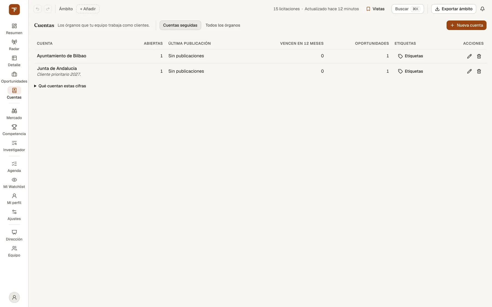
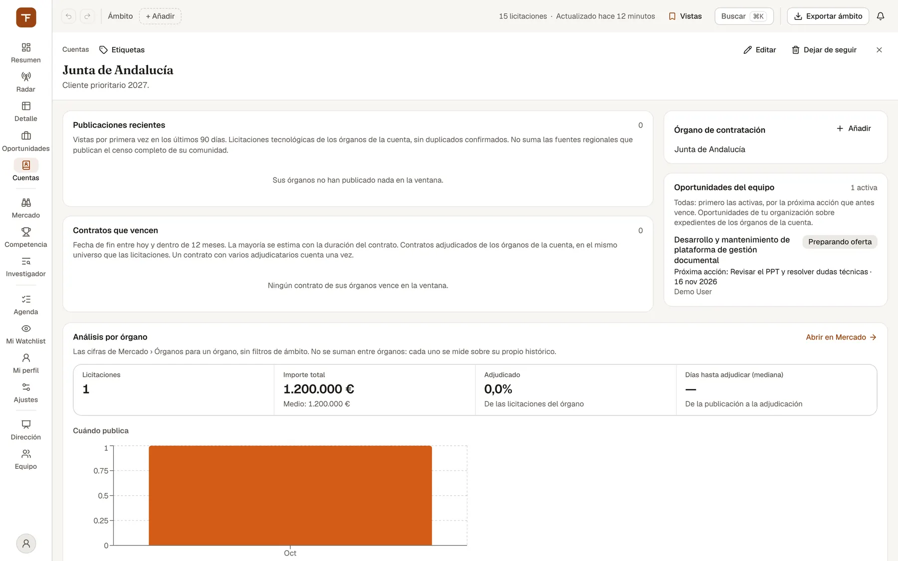

# Cuentas: los órganos que trabajas como clientes

> Cuentas convierte a un cliente público (uno o varios órganos de contratación) en una cuenta del equipo: ves qué publica, qué contratos suyos vencen y quién los tiene, y qué oportunidades tenéis abiertas con él.

## Para qué sirve y cuándo usarlo

Cuentas (`/cuentas`, en la barra lateral con la descripción «Los órganos que tu equipo trabaja como clientes») es para quien lleva la relación con unos clientes concretos: el responsable de cuenta o el comercial que tiene asignados unos ayuntamientos, diputaciones o consejerías.

Úsalo cuando quieras:

- **Seguir a un cliente con todos sus órganos.** Un cliente real suele contratar a través de varios órganos (por ejemplo, un ayuntamiento grande con varias áreas de gobierno). Una cuenta los agrupa bajo un nombre que el equipo reconoce.
- **Enterarte sin buscar.** Mientras la cuenta exista, **todos los miembros de la organización** reciben en la campana un aviso por cada publicación nueva de sus órganos («Publicación nueva de …») y otro cuando un contrato suyo entra en sus últimos seis meses («Vence en seis meses un contrato de …»).
- **Preparar el año.** La ficha de cada cuenta enseña los contratos que vencen en los próximos 12 meses y qué empresa los tiene: son las renovaciones que puedes preparar con tiempo.
- **Ver el histórico de cada órgano** sin salir de la ficha: cuánto licita, cuánto adjudica, cuánto tarda y cuándo publica.

Las cuentas son **de la organización activa**, no tuyas: lo que crea o cambia un compañero lo ves tú, y al revés.

## Qué ves en pantalla

### Las dos pestañas de `/cuentas`

| Pestaña | Qué hay |
| --- | --- |
| **Cuentas seguidas** | La cartera de cuentas de tu organización, con cuatro cifras por cuenta. Es la vista por defecto. |
| **Todos los órganos** | No repite el análisis: es un enlace, «Abrir Mercado › Órganos», al ranking completo de órganos con los filtros del ámbito. Desde allí también puedes seguir un órgano (ver más abajo). |

La pestaña elegida queda en la URL (`/cuentas?vista=mercado` para la segunda), así que puedes compartir el enlace.

### La tabla de cuentas

*Cuentas: los órganos que el equipo trabaja como clientes.*

Cada fila es una cuenta. Debajo del nombre aparece el órgano (si la cuenta tiene uno con otro nombre), o «N órganos» si tiene varios, y la nota en cursiva si la hay.

| Columna | Qué significa |
| --- | --- |
| Cuenta | Nombre de la cuenta. Pulsándolo abres su ficha. |
| Abiertas | Licitaciones de sus órganos con el plazo de ofertas abierto hoy y el expediente no cerrado. |
| Última publicación | Día en que se vio por primera vez el expediente más reciente de sus órganos. «Sin publicaciones» si no hay ninguno. |
| Vencen en 12 meses | Contratos adjudicados de sus órganos cuya fecha de fin cae entre hoy y dentro de 12 meses. La mayoría de esas fechas son **estimadas** a partir de la duración del contrato. |
| Oportunidades | Oportunidades de tu organización sobre expedientes de esos órganos que no están ganadas, perdidas ni retiradas. |
| Etiquetas | Las etiquetas del equipo aplicadas a la cuenta y, si tu rol puede escribir, el botón **Etiquetas** para cambiarlas. |
| Acciones | Editar (lápiz) y dejar de seguir (papelera). Solo si tu rol puede escribir. |

Las cifras se cargan aparte de la lista: mientras llegan verás una barra gris en su lugar, no un cero. Si no se pudieron calcular, o la cuenta es tan reciente que aún no tiene resumen, verás «—».

Bajo la tabla, el desplegable **Qué cuentan estas cifras** explica, para cada columna, la ventana de tiempo y el universo sobre el que se calcula, con el texto que da el servidor.

Si tu equipo aún no sigue nada, la pantalla lo dice («Tu equipo todavía no sigue ninguna cuenta») y, si tu rol puede escribir, ofrece el botón **Nueva cuenta**.

### La ficha de una cuenta (`/cuentas/<número>`)

*La ficha de una cuenta: publicaciones, contratos que vencen, oportunidades del equipo y análisis por órgano.*

Arriba, el enlace **Cuentas** para volver, las etiquetas, el nombre y la nota. A la derecha, **Editar** y **Dejar de seguir** (solo si tu rol puede escribir) y la X para cerrar la ficha (vuelve a la lista).

Cada bloque indica debajo de su título sobre qué cuenta y en qué ventana, para que «3 publicaciones» no se lea como «el cliente solo publicó tres cosas». Junto al título va el recuento: el total de publicaciones o de contratos, y en Oportunidades del equipo, cuántas están activas.

| Bloque | Qué muestra |
| --- | --- |
| **Publicaciones recientes** | Expedientes de sus órganos vistos por primera vez en los últimos 90 días. Cada uno con órgano, importe (dice «sin IVA» o «con IVA» cuando se sabe), «Publicada <fecha>», «Plazo <fecha>» si lo tiene y la marca **Abierta** si aún admite ofertas. El título abre la ficha de la licitación. |
| **Contratos que vencen** | Las renovaciones: contratos con fecha de fin en los próximos 12 meses. Cada uno con «Fin <fecha>» (con «(estimado)» si la fecha no viene publicada y se ha calculado), «Lo tiene <empresa>», el importe adjudicado y el órgano. El nombre de la empresa, cuando está identificada, abre su perfil en Competencia. |
| **Órgano de contratación** / **N órganos de contratación** | Los órganos que forman la cuenta. Cada nombre lleva a Mercado › Órganos con ese órgano ya buscado. Aquí se añaden y quitan órganos. |
| **Oportunidades del equipo** | Todas las oportunidades de tu organización sobre expedientes de esos órganos, primero las activas y ordenadas por la próxima acción que antes vence. Cada una con su estado y el responsable (o «Sin responsable»); las activas, además, con «Próxima acción: …» y su fecha (o «Sin próxima acción»). El título abre la oportunidad. |
| **Análisis por órgano** | El histórico de **un** órgano, con las mismas cifras que Mercado › Órganos y sin filtros de ámbito. Si la cuenta tiene varios órganos, elígelo en el selector **Órgano**. El enlace **Abrir en Mercado** lleva a Mercado › Órganos con ese órgano buscado, para ver su análisis completo. |

Cada bloque enseña como mucho 20 filas. En Publicaciones recientes y Contratos que vencen, si hay más, lo dice: «Se muestran 20 de N publicaciones» o «Se muestran 20 de N contratos».

En **Análisis por órgano** verás:

- **Licitaciones**: cuántas tiene el órgano en el histórico.
- **Importe total**, con el importe medio debajo.
- **Adjudicado**: porcentaje de sus licitaciones que están adjudicadas.
- **Días hasta adjudicar (mediana)**: de la publicación a la adjudicación.
- **Quién gana aquí**: gráfico de las empresas que más le han ganado.
- **Cuándo publica**: gráfico de su estacionalidad.

Las cifras **no se suman entre órganos**: cada uno se mide sobre su propio histórico. Si Mercado no tiene datos de ese órgano, verás «Mercado no tiene histórico de este órgano».

## Cómo se hace

### Crear una cuenta desde `/cuentas`

1. Pulsa **Nueva cuenta** (arriba a la derecha, en la pestaña Cuentas seguidas).
2. En **Órganos de contratación**, escribe al menos 3 letras del nombre del órgano. Aparecen hasta 20 órganos que existen en la base, cada uno con su número de expedientes.
3. Marca uno o varios (clic, o flechas y Enter). Los elegidos aparecen arriba como fichas; la X de cada una lo quita.
4. Si quieres, rellena **Nombre de la cuenta** (si lo dejas vacío, se llama como el primer órgano) y una **Nota** para el equipo.
5. Pulsa **Crear cuenta**. Un aviso lo confirma: «Cuenta «…» creada: avisará a todo el equipo».

Un órgano solo puede estar en una cuenta de tu organización: si ya está en otra, sale deshabilitado con el aviso «ya está en la cuenta «…»». Tampoco puede haber dos cuentas con el mismo nombre.

### Seguir un órgano desde Mercado

1. Abre Mercado › Órganos (o la pestaña **Todos los órganos** de Cuentas y pulsa **Abrir Mercado › Órganos**).
2. Abre el perfil de un órgano y pulsa el botón de seguir (icono de campana) junto a su nombre.
3. Si el órgano no estaba en ninguna cuenta, se crea una cuenta con él, con su nombre. Si ya estaba, no cambia nada. El aviso dice en qué cuenta quedó: «Órgano añadido a la cuenta «…» de tu organización».

Pulsarlo otra vez lo deja de seguir: el órgano sale de su cuenta y, si era el único órgano, la cuenta desaparece entera. Aquí no hay aviso con **Deshacer**: para recuperarla, vuelve a seguir el órgano (si la cuenta desapareció, se crea de nuevo sin nota ni etiquetas).

### Añadir o quitar órganos de una cuenta

1. Abre la ficha de la cuenta.
2. En el bloque de órganos pulsa **Añadir**, busca y marca los órganos como al crearla, y pulsa **Añadir órgano** (o **Añadir N órganos**). La cuenta avisará también de lo que publiquen y de sus contratos que venzan.
3. Para quitar uno, pulsa la X junto a su nombre. Esa X solo aparece si la cuenta tiene más de un órgano: el último no se puede quitar; para eso está **Dejar de seguir**.

### Renombrar la cuenta o cambiar su nota

1. Pulsa el lápiz en la fila de la lista o **Editar** en la ficha.
2. Cambia **Nombre de la cuenta** o **Nota** y pulsa **Guardar**. Si vacías la nota, se borra.

Solo se guarda lo que cambiaste, así que no pisas la edición que haya hecho un compañero en el otro campo.

### Poner etiquetas a una cuenta

1. Pulsa **Etiquetas** en la fila o en la cabecera de la ficha.
2. Marca las etiquetas del equipo que quieras aplicar, o escribe una en **Nueva etiqueta** y créala. Son las mismas etiquetas que se usan en favoritos y oportunidades (máximo 30 por organización).

### Dejar de seguir una cuenta (y deshacerlo)

1. Pulsa la papelera en la fila o **Dejar de seguir** en la ficha (desde la ficha vuelves a la lista).
2. Aparece el aviso «Dejaste de seguir «…»»: ya no avisará al equipo de sus publicaciones ni de sus vencimientos, y sus órganos quedan libres para otra cuenta.
3. Si fue un error, pulsa **Deshacer** en ese aviso. La cuenta se vuelve a crear con su nombre, sus órganos, su nota y sus etiquetas. Ojo: tiene un número nuevo, así que un enlace guardado a la ficha antigua ya no funciona (abre «No se pudo abrir esta cuenta»).

No hay paso de confirmación: el aviso con Deshacer es la red de seguridad, y dura lo que dura el aviso en pantalla.

## Quién puede usarlo

- **Todos los miembros** de la organización ven las cuentas, sus cifras y sus fichas, y reciben sus avisos en la campana.
- Crear, editar, etiquetar, añadir o quitar órganos y dejar de seguir lo puede hacer **cualquier rol que escriba**, no solo quien creó la cuenta: la cartera es del equipo.
- Con **rol de solo lectura** la pantalla te lo dice («Tu rol en esta organización es de solo lectura: ves las cuentas del equipo, pero no puedes crearlas ni cambiarlas») y no muestra los botones de cambio. En el perfil de un órgano en Mercado, en vez del botón de seguir verás «Cuenta: <nombre>» si el órgano ya es de una cuenta.

Los roles se gestionan en Equipo: ver [Equipo y Dirección](12-equipo-y-direccion.md).

## Límites y avisos

- **De dónde salen las cifras.** Las de la lista y las de Publicaciones recientes y Contratos que vencen las calcula el servidor sobre las licitaciones tecnológicas de los órganos de la cuenta, sin duplicados confirmados, y **sin sumar las fuentes regionales** que publican el censo completo de su comunidad. Un contrato con varios adjudicatarios cuenta una vez. Los avisos de la campana salen del mismo universo. Las oportunidades son las de tu organización, y el Análisis por órgano usa las cifras de Mercado › Órganos.
- **Fechas de fin estimadas.** Muchos contratos no publican su fecha de fin; se estima con la duración del contrato y la ficha la marca «(estimado)». Tómala como orientación para preparar la renovación, no como fecha oficial.
- **Dos ventanas distintas.** La tabla y la ficha miran 12 meses de vencimientos; el aviso de la campana llega cuando el contrato entra en sus **últimos seis meses**. Si la fecha de fin cambia (una prórroga), el contrato puede volver a avisar.
- **«Quién gana aquí» es histórico**, no una predicción: dice quién ha ganado en ese órgano, no quién va a ganar. TenderFlow no da probabilidad de ganar.
- **Un órgano, una cuenta.** Dentro de una organización no puedes tener el mismo órgano en dos cuentas. Otra organización sí puede seguir el mismo órgano por su cuenta.
- **Solo órganos que existen.** No se puede escribir un cliente a mano: hay que elegir órganos reales de la base. Si buscas «Ayuntamiento de X» y no sale, prueba con el nombre de sus áreas o servicios.
- **Las listas de la ficha están recortadas a 20 filas** por bloque. En publicaciones y contratos el total va en el recuento junto al título; en Oportunidades del equipo el recuento son las activas, y si tenéis más de 20 oportunidades con el cliente, las que quedan al final del orden (las cerradas y las menos recientes) no salen en la ficha (búscalas en [Oportunidades](05-oportunidades.md)).

## Relacionado

- [Mercado](07-mercado.md): el ranking de órganos y el perfil desde donde también se sigue un órgano.
- [Detalle y ficha de licitación](04-detalle-y-ficha.md): lo que abres al pulsar una publicación o un contrato.
- [Oportunidades](05-oportunidades.md): lo que abres desde «Oportunidades del equipo».
- [Competencia](09-competencia.md): el perfil de la empresa que tiene el contrato que vence.
- [Agenda y Mi Watchlist](06-agenda-y-watchlist.md): seguimiento personal de expedientes, frente al seguimiento de equipo que es una cuenta.
- [Equipo y Dirección](12-equipo-y-direccion.md): roles y organizaciones.
- [Glosario](15-glosario.md).
