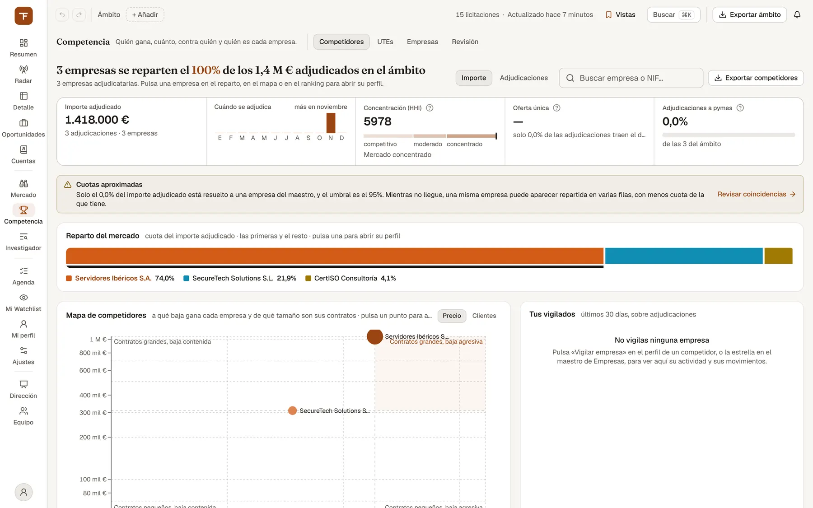

# Competencia: quién gana y contra quién

> Saber quién se lleva los contratos de tu ámbito, con cuánta cuota, a qué baja, con quién se alía en UTE y cómo te ha ido contra cada empresa.

## Para qué sirve y cuándo usarlo

Competencia es el espacio de análisis competitivo (`/competencia`). Lo usan sobre todo preventa y dirección (CU-18):

- **Antes de decidir si te presentas**: quién suele ganar en ese órgano, comunidad o familia CPV, y a qué baja.
- **Al preparar la oferta**: cuánto rebaja de media el rival que esperas encontrarte y con quién va en UTE.
- **Para vigilar a rivales concretos**: territorios o nichos nuevos en los que empiezan a ganar.
- **Para mantener limpio el registro de empresas** (el *maestro*), del que dependen todas las cuotas.

Todo lo que ves sale de adjudicaciones publicadas. El espacio describe el mercado; **no te da una probabilidad de ganar**.

Los enlaces antiguos siguen funcionando: `/competidores`, `/utes`, `/empresas` y `/licitadores` te llevan a la vista correspondiente de este espacio.

## Qué ves en pantalla

El espacio tiene cuatro vistas (pestañas bajo el título): **Competidores**, **UTEs**, **Empresas** y **Revisión**. Si hay coincidencias de empresas pendientes, la pestaña Revisión lleva un contador, también desde las otras vistas.

Qué filtros de la barra de ámbito aplica cada vista:

| Vista | Filtros del ámbito que aplica |
| --- | --- |
| Competidores | Periodo, comunidad autónoma, tecnología, estado e importe (con las excepciones de cada panel, abajo) |
| UTEs | Periodo y comunidad autónoma |
| Empresas y Revisión | Ninguno |
| Ficha de empresa | Periodo, comunidad autónoma, tecnología e importe mínimo |

### Vista Competidores

*Competencia › Competidores: reparto del mercado, mapa de competidores y empresas vigiladas.*

Primero el dibujo y después la lista. De arriba abajo:

- **Titular**: la conclusión en una frase, por ejemplo «5 empresas se reparten el 45 % de los 312,4 M€ adjudicados en el ámbito». Debajo, cuántas empresas adjudicatarias hay. Si el sistema solo ha recibido las empresas con más adjudicaciones, lo dice («la cifra cuenta solo las N con más adjudicaciones»).
- **Controles de la cabecera**: el conmutador **Importe / Adjudicaciones** (cambia el titular, el reparto y el orden del ranking), el buscador «Buscar empresa o NIF…» y el botón **Exportar competidores** (CSV o Excel).
- **Tira de cifras**:
  - **Importe adjudicado**, con el número de adjudicaciones y de empresas.
  - **Cuándo se adjudica**: adjudicaciones por mes del año, con el mes de más actividad resaltado.
  - **Concentración (HHI)**: índice de 0 a 10.000 sobre una regla de tres zonas. Por debajo de 1.500, «Mercado competitivo»; entre 1.500 y 2.500, «Concentración moderada»; desde 2.500, «Mercado concentrado».
  - **Oferta única**: porcentaje de licitaciones con un solo ofertante. Si no hay suficientes expedientes con el número de ofertas publicado, dice qué falta en vez de dar una cifra.
  - **Adjudicaciones a pymes**.
- **Avisos** (solo si aplican):
  - **«Ámbito recortado»**: el ámbito tiene más adjudicaciones de las que se analizan de una vez. Cuotas, concentración y totales salen entonces de las más recientes. Acota las fechas o añade un filtro.
  - **«Cuotas aproximadas»**: menos del 95 % del importe adjudicado está asignado a una empresa del maestro. Hasta llegar a ese umbral, una misma empresa puede aparecer partida en varias filas. Trae el enlace «Revisar coincidencias».
- **Reparto del mercado**: una barra al 100 % con las primeras empresas y el resto agrupado. Pulsa un nombre para abrir su perfil.
- **Mapa de competidores**: cada empresa es un punto cuyo tamaño es su cuota del importe. Tiene dos lentes:
  - **Precio**: a qué baja gana cada empresa frente al tamaño de sus contratos.
  - **Clientes**: a cuántos órganos adjudica frente a cuánto depende del primero.

  Las líneas discontinuas son las medianas de las empresas dibujadas, y la leyenda dice cuántas se quedan fuera por falta de dato.
- **Tus vigilados**: una fila por cada empresa que vigilas, con los últimos 30 días de adjudicaciones. Cada marca es un movimiento: **Territorio nuevo** (gana en una comunidad nueva), **Nicho nuevo** (en una familia CPV nueva) o **Racha** (tres adjudicaciones o más en la ventana). El nombre de cada empresa abre su ficha. Debajo, la lista **Movimientos**, con «Ver» para abrir cada licitación. Si no vigilas ninguna, el panel dice «No vigilas ninguna empresa».
- **Perfil del competidor**: se abre por defecto con la primera empresa del ranking. Muestra:
  - Su posición («n.º 3 de 1.284 por importe»).
  - **Importe adjudicado**, **Adjudicaciones**, **Cuota y posición** y **Baja media**, con la variación frente al periodo anterior cuando la hay.
  - Un resumen en texto.
  - **Dónde gana**: un mapa de comunidades con el peso de cada una en su importe.
  - **Quién le compra**: los órganos que más pesan en su importe.
  - **Progreso anual**.
  - **Contra ti**: una casilla por cada expediente en común en 24 meses. Los recuentos son «Ganaron ellos», «Perdimos», «Ganamos» y «Sin resolver». El enlace «Ver cada cruce en «Contra mí» del análisis completo» lleva al detalle en la ficha.

  La marca «Suma N identidades» indica que el competidor agrupa varias fichas del maestro. «UTE» indica que la empresa es una unión temporal. La X de la esquina cierra el perfil.
- **Cara a cara** (cuando eliges una segunda empresa): dos empresas enfrentadas en ocho medidas: Cuota del importe, Adjudicaciones, Importe medio, Baja media, Ofertas por expediente, Gana sin competencia, Órganos distintos y Peso del primer cliente. Cada barra va a escala de la mayor de las dos.
- **Dónde gana cada uno**: una matriz con las empresas que más adjudicaciones tienen por comunidad autónoma. **Pulsar la cabecera de una comunidad la añade o la quita del ámbito global**, y toda la pantalla se recalcula.
- **Concentración por segmento**: el HHI por **Familia CPV**, **Comunidad**, **Órgano** o **Tecnología**, en segmentos con 5 contratos adjudicados o más. Se ordena por «Más concentrados» o por «Más importe». Al elegir un segmento ves:
  - **Quién se lo reparte**: cuota de cada empresa, con su base de cálculo. Disponible por familia CPV o comunidad.
  - **A qué baja se gana**: baja media, mínima y máxima. Disponible por familia CPV u órgano.

  Por tecnología no hay desglose, y el panel lo dice.
- **Bajas medias**: tabla por **Órgano**, **Familia CPV** o **Comunidad**, con Contratos, Baja media, Rango (de la mínima a la máxima, con la media marcada) y Ofertas / exped. Solo entran grupos con 3 adjudicaciones o más con presupuesto y adjudicado.
- **Ranking de competidores**: dos formas de verlo.
  - **Con gráficos**: N.º, Empresa, Cuota del importe, Adjud., Importe, Baja media, Ofertas / exped., Sin competencia, Última adj. y el botón «Comparar». Muestra 12 filas y el botón «Ver los N» enseña el resto.
  - **Tabla completa**: doce columnas ordenables, con NIF, Contratos/año, Importe medio, % sin competencia y % órgano principal, entre otras.

  En el nombre, un ojo indica que vigilas la empresa, y una etiqueta como «2 CIF» o «3 nombres» indica que varias identidades se han agrupado.

### Vista UTEs

- **Titular**: compara el contrato medio en UTE con el contrato en solitario, con las dos cifras tal cual, por ejemplo «En UTE, el contrato medio es de 1,9 M€; en solitario, de 560.000 €». Al lado, **Exportar UTE**.
- **Tira de cifras**: **Adjudicaciones a UTE** e **Importe en UTE**, cada una frente a lo adjudicado en solitario, y **Importe medio por contrato** como dos barras.
- **Red de alianzas**: cada línea une a dos empresas que han firmado una UTE juntas, y su grosor indica cuántas. Muestra los pares con más UTE del ámbito, no todos. Pulsar una empresa resalta sus alianzas.
- **Las alianzas más repetidas**: la misma red en forma de lista, que se recorre con el teclado. Al elegir una empresa pasa a «Con quién se alía …». **Ver todas** vuelve a la lista completa.
- **Evolución**: UTE adjudicadas e importe, por mes.
- **Las UTE con más adjudicaciones**: cada fila es una UTE completa, con las adjudicaciones hacia la izquierda y el importe hacia la derecha. Tiene su propio buscador, «Buscar UTE…».

### Vistas Empresas y Revisión (el maestro)

El *maestro* es el registro único de empresas: une en una sola empresa *canónica* los distintos nombres y NIF con los que aparece en las fuentes.

En estas dos vistas, la cabecera muestra (en pantallas anchas) cuatro cifras:

- **Canónicas**: empresas en el maestro.
- **Importe resuelto**: porcentaje del importe adjudicado asignado a una empresa del maestro. Se marca «Bajo umbral» por debajo del 95 %. Abre la cola.
- **Vigiladas**: enlaza a Competidores.
- **Revisiones**: coincidencias dudosas pendientes. Abre la cola.

**Empresas** tiene dos partes:

- A la izquierda, la lista del maestro: Empresa (con las marcas UTE o PYME), NIF, Nº, Importe y una estrella para «Vigilar». Puedes buscar por «Nombre, alias o NIF», ordenar por columna y pasar de página (12 por página).
- A la derecha, la ficha de identidad de la empresa seleccionada:
  - El botón **Vigilar** (o «En vigilancia» si ya la vigilas).
  - El NIF canónico (o «Sin NIF canónico») y las marcas UTE o PYME.
  - El grupo empresarial, con un enlace que filtra el maestro por ese grupo.
  - **Actividad en todo el histórico** y el botón **Abrir ficha**.
  - **Miembros de la UTE** o **Participa en UTEs**.
  - **Alias vistos en fuente**.

**Revisión** es la cola de coincidencias dudosas. Cada fila muestra lo **Visto en fuente** (nombre y NIF), el **Candidato existente**, la **Similitud** y los botones de decisión. Si los NIF no coinciden, la fila lo marca en rojo con «NIF distinto».

### Ficha de empresa

Está en `/competencia/empresa/<id>` y se llega desde «Ver análisis y listado completo» del perfil, desde «Abrir ficha» del maestro (que la abre en «Todo el histórico») o pulsando el nombre de una empresa en Tus vigilados o en Quién se lo reparte. Contiene:

- **Cabecera**:
  - El enlace «Volver al mercado», que vuelve a Competidores.
  - El NIF, las marcas UTE y «Grupo …».
  - La trayectoria (primera y última adjudicación), las adjudicaciones históricas y los clientes públicos del periodo.
  - El botón «Vigilar empresa» («Dejar de vigilar» si ya la vigilas).
  - **Alcance**: «Tu ámbito» o «Todo el histórico».
  - **Periodo**, solo con «Tu ámbito»: «Filtro global» (si la barra tiene fechas), «12 meses», «3 años» o «Todo».
- **Pestaña Perfil**:
  - El **Perfil operativo**, un resumen en texto.
  - **Operativa en cifras**: Importe adjudicado, Adjudicaciones, Cuota y posición, Contrato típico (la mediana), Baja media, Presión competitiva (con la cobertura del dato), Clientes públicos, Territorios, Familias CPV y Adjudicaciones con oferta única.
  - **Participación en UTEs** (solo si figura en alguna): las UTE de las que es miembro y sus otros miembros.
  - **Progreso anual**.
  - **Dónde y para quién opera**: Especialización, Clientes principales y Huella territorial.
  - **Procedimiento y tamaño**.
  - **Cómo puntúa en las actas**.
  - **Cambios relevantes**.
  - **Histórico de adjudicaciones**, con buscador («Título o identificador»), filtro por órgano de contratación y orden («Más recientes», «Más antiguas», «Mayor importe», «Menor importe»).

  Si la empresa no tiene adjudicaciones en el ámbito, verás «Sin adjudicaciones dentro de este ámbito» y el botón «Ver todo el histórico».
- **Pestaña Identidad**: quién es en el maestro. Muestra el NIF canónico, otros NIF con los que aparece, el grupo, los alias y las relaciones de UTE, sin filtros, y el enlace «Ver en el maestro». Si la ficha suma varias identidades, enseña una tarjeta por cada una.
- **Pestaña Contra mí**: los expedientes en los que tu equipo presentó oferta y esta empresa aparece como adjudicataria. Columnas: Expediente, Resultado, Nuestra baja, Baja ganadora y Adjudicación. La ventana es de 12, 24 o 36 meses.

## Cómo se hace

### Ver quién gana en tu ámbito

1. Ajusta la barra de ámbito: periodo, comunidad, tecnología, importe.
2. Abre **Competencia › Competidores**.
3. Lee el titular y el **Reparto del mercado**. Cambia a **Adjudicaciones** si te interesa el número de contratos más que el dinero.
4. Si aparece «Ámbito recortado» o «Cuotas aproximadas», ten en cuenta ese aviso antes de citar cuotas.

### Estudiar a un rival

1. Pulsa su nombre en el reparto, en el mapa o en el ranking, o búscalo con «Buscar empresa o NIF…».
2. En el **Perfil del competidor**, revisa Dónde gana, Quién le compra y Contra ti.
3. Pulsa **Ver análisis y listado completo** para abrir su ficha. Si la empresa aún no está en el maestro, verás «Sin identidad en el maestro de empresas» y el enlace «Buscarla en Empresas».
4. En la ficha, cambia a **Todo el histórico** si quieres toda su actividad sin los filtros del ámbito.

### Comparar dos empresas

1. Abre el perfil de la primera.
2. En el ranking, pulsa **Comparar** en la fila de la segunda. Aparece el **Cara a cara**.
3. Para cambiar la segunda, pulsa «Comparar» en otra fila. Para cerrarlo, pulsa **Quitar** o vuelve a pulsar «Comparando» en su fila.

### Encontrar segmentos concentrados y su baja

1. En **Concentración por segmento**, elige el corte (Familia CPV, Comunidad, Órgano o Tecnología) y el orden.
2. Pulsa un segmento para ver **Quién se lo reparte** y **A qué baja se gana**. Pulsarlo otra vez lo cierra.
3. Para comparar bajas en tu ámbito, usa **Bajas medias** y elige la agrupación.

### Ver con quién se alía una empresa

1. Abre **Competencia › UTEs**.
2. Pulsa la empresa en la **Red de alianzas** o en la lista de al lado.
3. **Ver todas** vuelve a todas las alianzas.

### Vigilar una empresa

1. Pulsa **Vigilar empresa** en el perfil del competidor o en la ficha de empresa, o en el maestro la estrella de su fila o el botón **Vigilar** de su identidad. En el maestro, el aviso confirma «Añadida a la vigilancia · alerta diaria».
2. La empresa aparece en **Tus vigilados**, y recibirás por correo sus adjudicaciones nuevas y los contratos suyos que vencen en los próximos 90 días.
3. Para dejar de vigilarla, vuelve a pulsar el mismo botón, que ahora dice «Vigilando» en el perfil, «Dejar de vigilar» en la ficha y «En vigilancia» en el maestro, o la estrella.

### Revisar tu historial contra un competidor

1. Abre su ficha y la pestaña **Contra mí**.
2. Elige la ventana.
3. Lee cada resultado:
   - **Ganaron ellos**: el adjudicatario publicado es esa empresa.
   - **Perdimos**: cerraste la oportunidad como perdida, pero no consta que ganara esa empresa.
   - **Ganamos**.
   - **Sin resolver**: el cierre no es concluyente o hay una contradicción.
4. Si ves el aviso de que tu organización no ha declarado su NIF, decláralo en Equipo con el enlace «Declararlo en Equipo › Organización».

### Buscar una empresa en el maestro

1. Abre **Competencia › Empresas** y escribe un nombre, un alias o un NIF.
2. Selecciona una fila para ver su identidad. Pulsa un miembro de UTE para saltar a esa empresa.

### Resolver coincidencias dudosas (solo administradores)

1. Abre **Competencia › Revisión**.
2. Filtra por similitud con **Todos**, **≥ 90 %** o **< 90 %**.
3. Decide cada fila:
   - **Unir**: es la misma empresa que el candidato.
   - **Nueva**: es una empresa distinta y se crea aparte.
4. Para decidir varias a la vez, pulsa **Unir los ≥ 90 % (N)** y confirma con **Unir todos**.
5. Cada decisión se puede deshacer con **Deshacer** en el aviso, durante unos 6 segundos. Después se guarda y se recalculan el importe resuelto y las cuotas para todos.

### Exportar

- **Exportar competidores** y **Exportar UTE** descargan los datos de la vista en CSV o Excel, con el ámbito aplicado.
- En la ficha, **Exportar CSV** del Histórico de adjudicaciones descarga las adjudicaciones de la empresa en el alcance elegido, con la búsqueda y el órgano que hayas escrito.

## Quién puede usarlo

- Competidores, UTEs, Empresas y la ficha de empresa están disponibles para cualquier usuario con sesión.
- **Revisión** está reservada a administradores de la plataforma, porque cada decisión reescribe el maestro para todas las organizaciones. Los demás usuarios ven «Cola reservada a administradores» con el número de pendientes.
- **Contra ti** y **Contra mí** usan las oportunidades de tu organización activa.

## Límites y avisos

- **De dónde salen las cifras**: de adjudicaciones publicadas en las fuentes que TenderFlow ingiere. Ninguna cifra es una probabilidad de ganar.
- **Cuotas**: dependen de que el maestro haya asignado cada adjudicación a una empresa. Por debajo del 95 % de importe resuelto, la pantalla avisa con «Cuotas aproximadas».
- **Volumen analizado**: el análisis de Competidores tiene un tope de adjudicaciones por consulta («Ámbito recortado») y solo recibe las empresas con más adjudicaciones. El titular avisa cuando la cifra es parcial.
- **El buscador de Competidores** filtra el ranking, el mapa y la matriz «Dónde gana cada uno». No filtra el titular ni el reparto, que siempre describen el mercado completo.
- **Concentración por segmento no sigue la barra de ámbito**: usa todo el histórico observado, y el panel lo indica.
- **Bajas medias** solo aplica comunidad, fechas de adjudicación e importe mínimo. Si tienes otros filtros activos, el panel dice cuáles no aplica.
- **Base del importe**: las bajas indican al pie si se calcularon solo sobre presupuestos con base sin IVA declarada, sobre una base mixta o sin base de importe declarada.
- **Sin dato suficiente**: verás «sin baja publicada», «sin dato» o «—» en lugar de un cero.
  - En las actas, con menos de 3 no hay media («Solo N actas»).
  - En Procedimiento y tamaño, no se da media por debajo de 5 adjudicaciones por celda.
  - Un segmento necesita 5 contratos para tener HHI, y un grupo de bajas, 3.
- **Cómo puntúa en las actas**: se basa solo en actas de mesa ya leídas y no sigue los filtros del periodo.
- **Participación en UTEs**: muestra importes adicionales, ya contabilizados a nombre de la UTE. No los sumes a los totales de la empresa.
- **Contra mí sin tu NIF**: si tu organización no ha declarado su NIF, de un cierre perdido solo se puede afirmar «Perdimos», no quién ganó.
- **Empresas fuera del maestro**: los adjudicatarios que aún no se han incorporado al maestro no aparecen en Empresas, y su perfil no tiene ficha.

## Relacionado

- [Primeros pasos](01-primeros-pasos.md): la barra de ámbito y las vistas.
- [Detalle y ficha](04-detalle-y-ficha.md): la ficha de cada licitación.
- [Oportunidades](05-oportunidades.md): los cierres que alimentan «Contra mí».
- [Mercado](07-mercado.md): órganos, geografía y renovaciones.
- [Equipo y Dirección](12-equipo-y-direccion.md): declarar el NIF de la organización.
- [Ops y Admin](13-ops-y-admin.md): tareas de administración.
- [Glosario](15-glosario.md): HHI, oferta única, baja, UTE y pyme.
