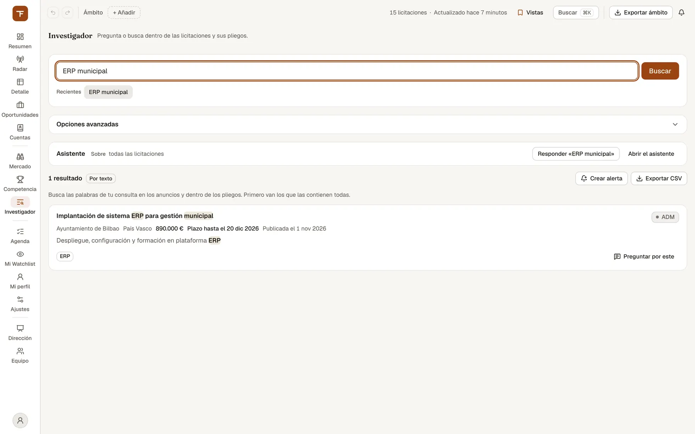

# Investigador: preguntar a los pliegos

> Buscar con tus palabras dentro de las licitaciones y de sus pliegos, y preguntar al asistente, que responde citando de dónde saca cada dato.

## Para qué sirve y cuándo usarlo

El **Investigador** (`/investigador`, tecla `6`; en el rail va en el bloque de análisis, junto a Mercado y Competencia, y la paleta ⌘K lo lista bajo «Análisis») es la pantalla para cuando no sabes qué expediente buscas, pero sí qué te interesa: «mantenimiento SAP abiertas en Andalucía», «baja temeraria», «¿qué solvencia piden en los contratos de ciberseguridad?».

Lo usan sobre todo el preventa y el comercial:

- para **encontrar** expedientes por lo que dice el anuncio o por lo que pone dentro del pliego, aunque el título no lo diga;
- para **preguntar** sobre esos expedientes (solvencia, criterios, plazos) y leer la respuesta con la cita del pliego delante;
- para **recuperar lo que tu equipo ya escribió**: si tu organización lo ha permitido, la respuesta enseña también extractos literales de vuestras propias ofertas (ver más abajo).

Hay una sola caja. Lo que escribes **siempre se busca**; si además es una pregunta, el asistente la responde en un panel a la derecha, sin tapar la lista.

## Qué ves en pantalla

### La caja de consulta

- El campo «Busca o pregunta» (hasta 500 caracteres) y el botón **«Buscar»** («Buscando…» mientras trabaja).
- **Recientes**: tus últimas 10 consultas, como botones para repetirlas. Se guardan en tu cuenta, así que te siguen a otro navegador. Una búsqueda que falla no se apunta.
- **Ámbito aplicado**: las comunidades, tecnologías y fechas de la barra de ámbito que están acotando la búsqueda. Solo aparece si has activado «Aplicar el ámbito» en «Opciones avanzadas» (por defecto, el Investigador **no** usa la barra de ámbito).
- **Entendido de tu frase**: lo que la búsqueda leyó en tu texto como filtro, en etiquetas. Por ejemplo «Andalucía», «Más de 500.000 €», «Abiertas», «Publicadas desde el …», «Cierran del … al …», «Procedimiento: …», «Órgano: …» o «Más recientes primero». Si no buscó exactamente tus palabras, lo dice con «Se buscó «…»»: las palabras de petición («puedes mirar…») y las que se convirtieron en filtro no se buscan.

### Opciones avanzadas

Un panel plegado debajo de la caja. Lo que cambies se guarda **solo en este navegador**.

| Control | Qué hace |
| --- | --- |
| Resultados | Cuántos resultados trae la primera tanda (de 1 a 50; 10 por defecto). |
| Tipo de coincidencia | Entre «Solo palabras» y «Más por significado»: cuánto pesa el parecido de significado al completar la lista. **Solo aparece** cuando alguna búsqueda ha llegado de verdad por significado y texto; si la búsqueda responde solo por texto, no hay nada que ajustar. |
| Modelo del asistente | «Por defecto» o uno de los modelos disponibles. Afecta a la respuesta, no a la lista. |
| Aplicar el ámbito (CCAA, tecnología y fechas) | Acota la lista y el asistente con la barra de ámbito. El resto del ámbito (estado, importe…) no viaja. |

### La lista de resultados

*El Investigador tras una búsqueda: la barra del asistente y la lista de resultados con los términos resaltados.*

Arriba, el recuento («12 resultados», o «Los primeros 10 resultados» si hay más) y una etiqueta con **cómo se buscó**, con su explicación debajo:

| Etiqueta | Qué significa |
| --- | --- |
| Por texto | Busca tus palabras en los anuncios y dentro de los pliegos. Primero van los que las contienen todas. |
| Por significado y texto | Primero lo que contiene todas tus palabras; después, lo que se le parece por significado en los pliegos aunque no las use. |
| Coincidencia literal | Ninguna palabra aparece como tal; estos resultados contienen parte del texto. Sin orden de relevancia: los más recientes primero. |
| Solo filtros | Tu consulta no traía palabras que buscar: es lo más reciente dentro de los filtros leídos. |

A la derecha, **«Crear alerta»** y, si hay algún resultado, **«Exportar CSV»**.

Cada resultado es una tarjeta con:

- el **título** (con las palabras que casan resaltadas), que abre la ficha de la licitación, y su **estado**;
- órgano, comunidad autónoma, importe, «Plazo hasta el …» o «Plazo cerrado el …» y «Publicada el …»;
- un **extracto** del anuncio con lo que casa resaltado;
- si casa en un documento, el **pasaje del pliego**, rotulado con su origen: «Pliego administrativo», «Pliego técnico» o «Documento adicional», el nombre del fichero y la página («p. 14»). Si llegó solo por parecido, se rotula «Fragmento parecido del pliego»;
- marcas de por qué salió: «Coincide en el pliego» (no en el anuncio), «Parecido por significado» o «También por significado», las tecnologías detectadas, y «Falta: «…»» con las palabras de tu consulta que no contiene;
- «Ver en la fuente» (el anuncio en el portal de origen, cuando el anuncio trae enlace) y **«Preguntar por este»** / «Quitar del asistente».

Las tarjetas **no llevan un porcentaje de relevancia**: dónde casa y qué falta es lo que explica por qué está ahí.

### La barra «Asistente»

Encima de la lista, una barra dice **sobre qué** responderá el asistente: «todas las licitaciones» o los resultados que hayas marcado (hasta tres, cada uno con su «×» para quitarlo). Sus botones:

- sin nada marcado: «Responder «tu consulta»» y «Abrir el asistente»;
- con resultados marcados: «Preguntar por lo marcado».

### El panel del asistente

Se abre a la derecha y **no bloquea la pantalla**: puedes seguir marcando resultados con él abierto, y la siguiente pregunta ya va sobre lo marcado. `Esc` lo cierra; pulsar fuera no. La conversación sigue ahí si lo cierras y lo vuelves a abrir.

Antes de preguntar, ofrece «Preguntas de ejemplo» según el contexto, y con un solo expediente, «Resumir el expediente». Abajo, otra vez el «Sobre», la caja de la pregunta («Escribe una pregunta…», o «Pregunta sobre esta licitación y sus pliegos…» con un expediente), el botón de enviar (la flecha), que mientras responde pasa a ser el de detener (el cuadrado), y, cuando ya hay conversación, «Nueva conversación» (y «Resumir el expediente» si hay uno solo). Un resumen trae además «Regenerar», para rehacerlo.

Debajo de cada respuesta puede aparecer:

| Bloque | Qué es |
| --- | --- |
| **Citado del pliego (N)** | Las citas que la respuesta usó, ya comprobadas: expediente, tipo de documento, fichero, página y el texto literal. Las que apuntaban a un documento que no estaba en el contexto se descartan. |
| **De documentos de tu organización (N)** | Extractos literales de vuestros adjuntos, con el fichero, la página, «Oportunidad: …» (enlace a la oportunidad de la que salen) y «Descargar el fichero». Como mucho tres por pregunta, y solo si algún pasaje de vuestros documentos casa con ella: si no casa ninguno, el bloque no aparece. |
| **Sin fuentes en el pliego** | La respuesta no cita ningún fragmento de los documentos. No dice que sea falsa: dice que el pliego no la sostiene. |
| **Fuentes del pliego (N)** | Plegado: todos los fragmentos que se le pasaron al modelo, usados o no. Cada expediente enlaza a su ficha. |
| «Generado automáticamente · revisa el pliego» (o «… revisa los pliegos citados») | Recordatorio de que el texto es de un modelo, no un dato del expediente. |
| «Respuesta útil» / «Respuesta no útil» | Los pulgares para valorar la respuesta. |

## Cómo se hace

### Buscar con tus palabras

1. Escribe lo que buscas en la caja, como lo dirías: el lugar, el importe, «abiertas» o un órgano se leen como filtros.
2. Pulsa «Buscar» (o `Intro`). Si la pantalla está en blanco, puedes empezar por una de las consultas de «Prueba con».
3. Revisa «Entendido de tu frase». Si un filtro leído no es lo que querías, pulsa **«Buscar el texto tal cual»**: se busca sin leer filtros («Buscando el texto tal cual, sin leer filtros en la frase.»). «Volver a leerlos» lo deshace.
4. Si hay más, pulsa «Mostrar más resultados». El tope es de 100; pasado ese número verás «Hay más resultados de los que se pueden enseñar: afina la búsqueda para verlos.». No se muestra un total: contarlo exigiría la búsqueda entera.
5. Pulsa un título para abrir su ficha. Al volver, la lista sigue donde estaba; el botón «atrás» del navegador vuelve a la consulta anterior. La consulta va en la dirección de la página, así que puedes guardarla o compartirla con quien tenga acceso.

### Preguntar al asistente sobre todas las licitaciones (CU-23)

1. Escribe una pregunta en la caja. Cuenta como pregunta si lleva `¿` o `?`, o si empieza por palabras como «qué», «cuál», «cómo», «cuándo», «cuánto», «dónde», «quién», «por qué», «dime», «dame», «explica», «resume», «compara», «hay» o «existe».
2. Pulsa «Buscar»: se busca igual que siempre **y** se abre el asistente con tu pregunta, en una conversación nueva y sobre todas las licitaciones.
3. Si escribiste solo unas palabras sueltas («licencias SAP»), el asistente no se abre solo; usa «Responder «…»» en la barra «Asistente».
4. Para seguir preguntando en el mismo hilo, escribe en la caja del panel.

Sin expedientes marcados, el asistente responde con las licitaciones que vengan al caso y las cita; si no encuentra ninguna, responde con conocimiento general.

### Preguntar sobre unos expedientes concretos

1. En la lista, pulsa «Preguntar por este» en hasta tres resultados. Con tres marcados, el botón del resto queda apagado y explica por qué: «El asistente lee como mucho tres expedientes a la vez».
2. Pulsa «Preguntar por lo marcado»: abre el asistente sobre esos expedientes, sin preguntar nada todavía. Escribe tu pregunta en el panel o elige una de las de ejemplo (si el panel ya estaba abierto, escribe directamente).
3. Con un expediente, el asistente lee sus pliegos y cita los fragmentos; puedes pedir «Resumir el expediente». Con dos o tres, la respuesta cita cada dato con su expediente y la página.
4. Si uno no se pudo cargar o su pliego se recortó, lo verás en el aviso «Comparación incompleta» («No se pudo cargar…», «Solo con el anuncio, sin pliegos…», «Pliego recortado para que quepan todos…»).
5. Una consulta nueva en la caja suelta lo marcado: era de la lista anterior.

### Comprobar una cita

1. En «Citado del pliego», mira el expediente, el fichero y la página.
2. Abre la ficha del expediente (desde el título del resultado o desde «Fuentes del pliego») y, en el apartado **Pliegos**, abre ese documento. Para llegar a la página con la cita resaltada desde un dato extraído del pliego (CU-22), sigue [Detalle y ficha](04-detalle-y-ficha.md), «Leer el pliego con la cita delante».
3. Para un extracto de tu organización, pulsa «Descargar el fichero» (el enlace caduca) o «Oportunidad: …».

### Dejar que se citen los documentos de tu organización (CU-37)

Las citas propias no se activan en el Investigador, sino en cada oportunidad:

1. Abre la oportunidad y ve a **Adjuntos**.
2. En el fichero que quieras, activa **«Permitir que se cite»**.
3. Lee el aviso: los extractos literales se enseñarán a cualquier persona de tu organización, y a nadie de fuera; para buscarlos se guarda el texto, que se borra si quitas el permiso o retiras el fichero. Pulsa **«Permitir»** (o «Cancelar»).
4. Sigue el estado del fichero: «Leyendo el documento…», **«Se puede citar»**, «No se pudo leer» (con el motivo) o «Sin texto que citar». Si el tipo o el tamaño no lo permiten, verás «No se puede citar: …» en vez del interruptor.
5. Cuando el fichero está en «Se puede citar», el Investigador y el guion de la oferta pueden enseñar extractos de ese fichero bajo «De documentos de tu organización».
6. Para retirarlo, desactiva el interruptor: es inmediato y borra el texto guardado.

Ver también [Oportunidades](05-oportunidades.md).

### Convertir la búsqueda en una alerta

1. Con una búsqueda hecha (aunque no haya dado resultados), pulsa **«Crear alerta»**.
2. Se abre «Nueva regla de seguimiento» en Mi Watchlist con la búsqueda ya puesta: el texto buscado; las comunidades (las de la barra de ámbito si la aplicabas, y si no, las leídas en tu frase); el importe mínimo, el órgano y el procedimiento leídos en tu frase, y las tecnologías de la barra de ámbito si la aplicabas. Las fechas, el importe máximo y «Abiertas» no pasan. Antes de guardar verás cuánto avisaría.
3. La regla admite una comunidad, una tecnología y un órgano: si tu búsqueda tenía varios, se lleva el primero. El procedimiento solo pasa si era uno. Lo que el formulario no tiene como campo (tecnología, órgano, procedimiento) se enseña debajo, con «Quitar».

Detalle en [Agenda y Mi Watchlist](06-agenda-y-watchlist.md).

### Exportar los resultados

Pulsa **«Exportar CSV»**. Descarga los resultados que tienes en pantalla (no más) con: identificador, título, órgano, comunidad, estado, fecha límite, importe, dónde casa («anuncio», «pliego», «significado», unidos con «+» si son varios) y cómo se buscó (en el fichero va el código interno de la búsqueda, no la etiqueta de pantalla).

## Quién puede usarlo

- Cualquier persona con sesión en una organización puede buscar y preguntar.
- Las citas de documentos propios salen de la **organización activa** y solo las ve gente de esa organización; otra organización no las recibe ni preguntando lo mismo.
- Cambiar «Permitir que se cite» en un adjunto requiere poder escribir en la oportunidad. Quien solo lee ve el estado y las citas, pero no el interruptor. Cada cambio de permiso queda en el rastro de la organización.

## Límites y avisos

- **No es una probabilidad de ganar.** El Investigador encuentra y cita; no puntúa tus opciones.
- **La respuesta es generada.** Léela con sus citas. Si aparece «Sin fuentes en el pliego», no hay fragmento que la respalde; una pregunta general sin licitaciones que vengan al caso se responde con conocimiento general, y la respuesta dice que no sale de TenderFlow.
- **Sin pasajes no hay cita.** El asistente solo cita fragmentos que estaban en lo que se le pasó y descarta las citas que no puede comprobar. Sobre un expediente, si ni el anuncio ni el pliego traen el dato, lo dice antes de añadir contexto general. Con tus documentos pasa igual: si ningún pasaje de lo que tu organización permitió citar casa con la pregunta, no sale ningún extracto propio.
- **El texto de pliegos y anuncios lo escriben terceros** (los órganos de contratación). El asistente lo usa como dato, nunca como instrucciones.
- **Solo hay pliegos donde se han descargado y procesado.** Un expediente sin pliego procesado se busca y se responde con el anuncio. En un resumen lo dice: «Resumen basado solo en los datos del anuncio…», con el estado de cada documento (pendiente, error, escaneado sin texto…).
- **Las citas propias son extractos literales**, no texto generado: no se le pasan al modelo, y por eso puedes comprobarlas abriendo el fichero. Cuántos documentos pueden citarse, y de qué tipo y tamaño, lo fija el servidor. En un entorno sin las citas propias activadas, el interruptor no aparece. Si la consulta de vuestros documentos falla, la respuesta lo dice: «No se pudieron consultar los documentos de tu organización…».
- **Avisos del asistente**: «No se pudo buscar en las licitaciones» (la respuesta no se apoya en ellas; vuelve a preguntar), «Respuesta sin el contexto de este expediente» (no se pudo cargar el expediente pedido) y «El asistente no está disponible ahora mismo» (sin prosa, pero con la lista de licitaciones encontradas).
- **Fallos**: si la búsqueda falla verás «No se pudo completar la búsqueda» con «Reintentar». Si haces muchas preguntas seguidas, o tu organización agota su cupo de uso del asistente, verás «Demasiadas peticiones seguidas. Espera unos segundos.».
- **Sin resultados**: la pantalla te dice por qué puede ser: los filtros leídos en tu frase (con el botón «Buscar el texto tal cual»), el ámbito aplicado, o las palabras.
- **Cobertura**: solo contratos tecnológicos, como el resto de TenderFlow.

## Relacionado

- [Primeros pasos](01-primeros-pasos.md): la barra de ámbito y la paleta (⌘K), que también tiene «Abrir asistente».
- [Resumen](02-resumen.md): la barra «Pregúntale a tus licitaciones…» abre el mismo asistente.
- [Detalle y ficha](04-detalle-y-ficha.md): «Preguntar a la IA» desde la ficha, la bandeja «Comparar» y la página del pliego con la cita resaltada.
- [Oportunidades](05-oportunidades.md): adjuntos y permiso de cita.
- [Agenda y Mi Watchlist](06-agenda-y-watchlist.md): reglas de alerta.
- [Glosario](15-glosario.md).
