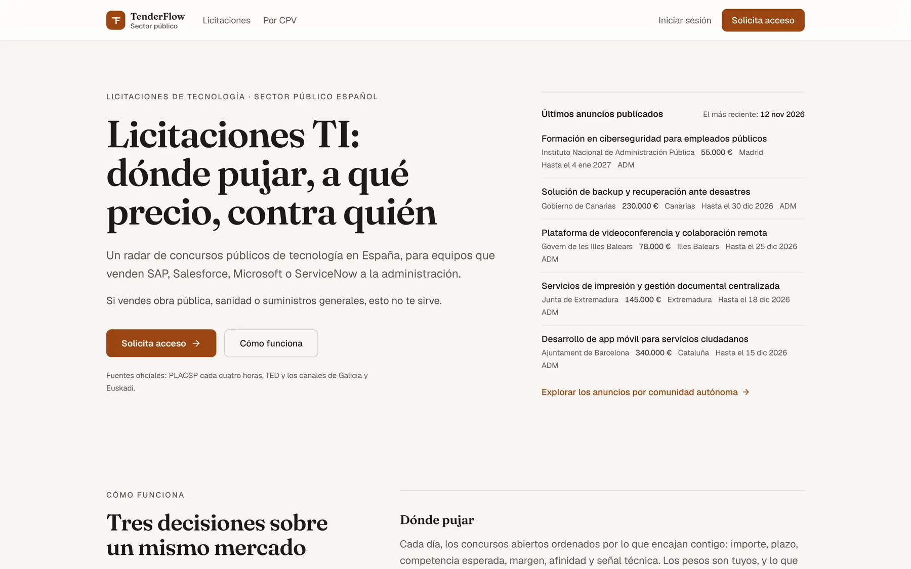
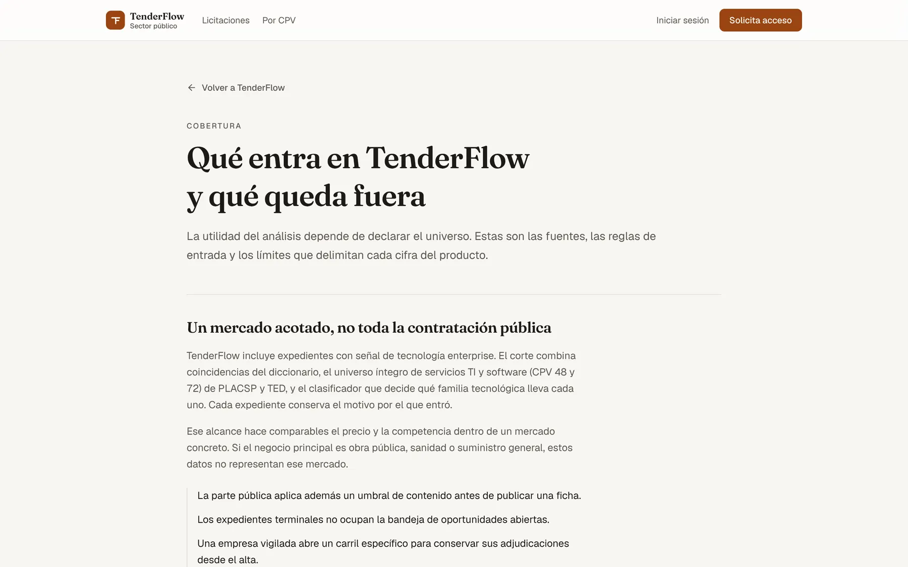

# Web pública e integraciones

> Lo que cualquiera puede ver sin cuenta, y las vías para sacar los datos de TenderFlow hacia tus propios sistemas: API, webhooks, feed de alertas, exportaciones, correo y el servidor MCP.

## Para qué sirve y cuándo usarlo

Este capítulo tiene dos partes:

- **La web pública** es lo que ve un visitante sin cuenta: la portada, los anuncios publicados agrupados por comunidad autónoma, por órgano y por código CPV, y tres páginas que explican de dónde sale el dato. Sirve para comprobar si TenderFlow cubre tus concursos antes de pedir acceso, y para enlazar o compartir una licitación concreta con alguien que no tiene cuenta.
- **Las integraciones** son para quien ya tiene cuenta y quiere que los datos lleguen a otro sitio sin abrir la consola: un CRM, un canal de Slack o Teams, una hoja de cálculo, un lector de feeds o un script propio. Las usan sobre todo el integrador y el propietario o administrador de la organización.

## Qué ves en pantalla: la web pública

Todas las páginas públicas comparten cabecera y pie. En la cabecera: el logotipo (vuelve a la portada), los enlaces **«Licitaciones»** y **«Por CPV»**, **«Iniciar sesión»** y el botón **«Solicita acceso»**. En el pie: «Licitaciones», «Por CPV», «Cobertura», «Metodología», «Seguridad», «Aviso legal», «Contacto» (solo si la instalación tiene configurado un correo de contacto) y «Acceder».

| Página | Dirección | Para qué sirve |
| --- | --- | --- |
| Portada | `/` | Qué es el producto, a quién le sirve y el formulario para pedir acceso. |
| Licitaciones por comunidad | `/licitaciones` y `/licitaciones/<comunidad>` | Los anuncios publicados en cada comunidad autónoma. |
| Licitaciones por órgano | `/licitaciones/organo` y `/licitaciones/organo/<órgano>` | Los anuncios de cada órgano de contratación. |
| Licitaciones por CPV | `/cpv` y `/cpv/<código>` | Los mismos anuncios, agrupados por código CPV de ocho dígitos. |
| Ficha pública | `/licitaciones/<comunidad>/<título>/<referencia>` | Un anuncio concreto, con enlace al anuncio oficial. |
| Cobertura | `/cobertura` | Qué fuentes entran, en qué estado está cada una y qué queda fuera. |
| Metodología | `/metodologia` | Cómo se calculan el score, la referencia de precio y el contexto competitivo, y cuándo el producto dice que no sabe. |
| Seguridad | `/seguridad` | Los controles de acceso y de datos que hay implementados. |
| Aviso legal | `/aviso-legal` | Origen de los datos, reutilización, qué se hace con los datos de la solicitud de acceso. |

### La portada

*La portada pública, con los últimos anuncios publicados.*

De arriba abajo:

- **El titular** «Licitaciones TI: dónde pujar, a qué precio, contra quién», la advertencia «Si vendes obra pública, sanidad o suministros generales, esto no te sirve», los botones «Solicita acceso» y «Cómo funciona», y la nota de fuentes (PLACSP cada cuatro horas, TED y los canales de Galicia y Euskadi). Junto al titular, **«Últimos anuncios publicados»**: cinco anuncios reales, con la fecha del más reciente («El más reciente:») y el enlace «Explorar los anuncios por comunidad autónoma».
- **La franja de cifras**: «Expedientes publicables ahora mismo», «Comunidades autónomas con índice propio», «Códigos CPV con volumen suficiente» y «Último expediente incorporado». Se leen de la API con hasta una hora de retraso y cuentan solo la parte pública, no toda la contratación. Nunca se rellena con cifras inventadas: si la API falla al regenerar la página, se sigue viendo la última versión buena, y si no hay corpus que citar, la franja no aparece.
- **«Cómo funciona»**: las tres decisiones (dónde pujar, a qué precio, contra quién) y una captura del Radar. La propia captura avisa de que sus expedientes son datos de demostración.
- **Secciones explicativas** (qué entra, de dónde sale cada número, qué haces con ello), la **FAQ** y **«Explora los concursos publicados»**.
- **El cierre**, con el formulario de solicitud de acceso.

### Los índices y los listados

- **`/licitaciones`** muestra una tarjeta por comunidad con su número de licitaciones y, al pie, los enlaces «Índice por código CPV» e «Índice por órgano de contratación».
- **`/licitaciones/organo`** y **`/cpv`** hacen lo mismo por órgano y por código.
- **El listado de un hub** (una comunidad, un órgano o un código) dice arriba cuántas hay publicadas y muestra 50 por página, de la más reciente a la más antigua. Cada fila trae el título, el órgano y, si existen, el importe, el CPV, la provincia, el plazo («Hasta el …» o «Plazo cerrado el …») y el estado. Las páginas siguientes se piden con `?p=2`, `?p=3`…

### La ficha pública

- Arriba, las migas de pan y unas etiquetas: la fuente, el estado y el número de expediente.
- El título y la descripción del anuncio.
- Tres datos destacados: **«Presupuesto»**, **«Fecha límite»** (o «Plazo cerrado») y **«Publicación»**.
- **«Datos del anuncio»**: órgano de contratación, CPV, tipo de contrato, procedimiento, tramitación, inicio y fin de ejecución, duración, provincia y comunidad. Lo que la fuente no publica no aparece.
- **«Lotes (N)»**, si los hay: número, objeto, CPV e importe de cada lote.
- Un recuadro con la fuente, la fecha de la última actualización y el enlace **«Ver el anuncio oficial»**, con el recordatorio de que para presentar oferta vale el documento del perfil del contratante.
- Los botones **«Más licitaciones en <comunidad>»** y **«Ya tengo cuenta»**, y el cierre «Esto es solo la parte pública» con «Solicita acceso».

### Cobertura, Metodología y Seguridad

*Cobertura: qué entra en TenderFlow y qué queda fuera.*

- **Cobertura** lista las **«Fuentes declaradas»** con su estado: **«Activa»** (se ingiere en cada pasada y su silencio genera una alerta), **«Opcional»** (puede estar apagada porque le falta configuración) o **«Fuera de alcance»**. Cada una dice su alcance, su identificador y tras cuántas horas sin una ingesta correcta se declara atrasada. Debajo, **«Fuera de alcance declarado»**, con la fecha de cada decisión. La lista sale del mismo inventario que vigila la ingesta; si no se pudo leer, la página lo dice en vez de enseñar una lista incompleta. No hay ninguna cuota de mercado: cada fuente cubre un universo distinto y no se suman. Al final, **«Familias observadas»**: los fabricantes y categorías de TI que el producto reconoce.
- **Metodología** explica el score (de 0 a 100; pesos por defecto 20, 15, 20, 20, 15 y 10 para importe, plazo, competencia, margen, afinidad y señal técnica; bandas Caliente desde 75, Atractiva desde 50, Tibia desde 25 y Descarte por debajo), la referencia de precio (responde «insuficiente» con menos de 30 pares comparables) y el contexto competitivo.
- **Seguridad** describe los controles de sesión, segundo factor, claves de API y datos. Dice expresamente que no afirma certificaciones (ISO 27001, ENS) ni auditorías externas.

## Cómo se hace: la web pública

### Comprobar si TenderFlow cubre tus concursos (CU-21)

1. Entra en `/licitaciones` y abre tu comunidad, o en `/cpv` y abre el código de lo que vendes.
2. Recorre el listado y abre una ficha para ver qué datos trae el anuncio.
3. Si no ves tu sector, mira `/cobertura`: el producto solo recoge contratos con señal de tecnología enterprise, no toda la contratación pública.

### Pedir acceso (CU-31)

1. Pulsa **«Solicita acceso»** en cualquier página; te lleva al formulario de la portada.
2. Rellena **«Email de trabajo»** (obligatorio) y, si quieres, **«Empresa»** y **«¿Qué quieres mirar? (opcional)»**.
3. Marca la casilla de consentimiento (sin ella la solicitud no se guarda) y pulsa **«Enviar solicitud»**.
4. Verás **«Solicitud recibida»**. Una persona revisa la cola y habilita tu correo o el dominio de tu empresa a mano; la respuesta llega por correo y no hay plazo comprometido.

Si algo falla, la misma página lo explica: «Ese email no parece válido», «Falta aceptar el tratamiento de los datos», «Demasiados envíos desde tu conexión» (espera un minuto) o «No hemos podido registrar la solicitud», con el botón «Volver al formulario». Si el email no era válido, lo demás que escribiste tampoco se guardó y hay que volver a ponerlo. El formulario funciona aunque el navegador tenga JavaScript desactivado. Qué pasa después (el correo de acceso concedido y la creación de la cuenta) está en [Primeros pasos](01-primeros-pasos.md).

### Compartir una licitación con alguien sin cuenta

Copia la dirección de su ficha pública. La dirección incluye un fragmento del título; si cambia, la referencia sigue llevando a la ficha correcta.

Las páginas públicas (portada, índices, listados y fichas) también se encuentran desde los buscadores: TenderFlow publica para ellos un mapa del sitio y la dirección canónica de cada página, así que quien busque un concurso puede llegar a su ficha pública sin pasar por la portada.

## Qué ves en pantalla: las integraciones

| Vía | Dónde se configura | Quién | Qué saca |
| --- | --- | --- | --- |
| API REST con clave | Ajustes › Claves de API | Cualquier usuario | Licitaciones y lo que permita la clave, sin navegador. |
| Feed de alertas | Ajustes › Claves de API (casilla al crear la clave) | Cualquier usuario | Lo que casan tus reglas de watchlist, en un lector de feeds. |
| Webhooks del equipo | Equipo › Integraciones | Propietario y administradores | Eventos de la organización hacia tu sistema, Slack o Teams. |
| Exportación CSV/Excel | Botón «Exportar ámbito» y exportaciones de cada pantalla | Cualquier usuario | Las licitaciones del ámbito en un fichero. |
| Correo | Ajustes › Notificaciones, Mi Watchlist, Equipo › Organización | Según el correo | Alertas, avisos e informe semanal. |
| Servidor MCP | Lo da de alta el operador | Solo administradores de la plataforma | Consultas de solo lectura desde Claude u otro cliente MCP. |

## Cómo se hace: las integraciones

### Consultar la API con una clave (CU-14)

1. Crea la clave en **Ajustes › Claves de API** y guárdala en el momento: no se vuelve a mostrar. El paso a paso, la rotación y la revocación están en [Ajustes](11-ajustes.md).
2. Envíala en la cabecera `X-API-Key` de cada petición, sin sesión de navegador. Las direcciones de la API cuelgan de `/api/v1/` en el mismo dominio de la aplicación; la referencia interactiva está en `/api/docs`.
3. Para rotarla sin cortar la integración, usa «Rotar» y elige el margen durante el que sigue valiendo la anterior. «Revocar» la corta al momento.

**Qué abre la clave.** La que se crea desde Ajustes nace con el permiso mínimo, **lectura de licitaciones**: el listado, la búsqueda, el volcado por cursor y el detalle de un expediente, además de adjudicaciones, resoluciones de recursos y los valores válidos de cada filtro. Con la casilla del feed suma **lectura de tus alertas**. Ajustes no permite elegir más permisos: exportaciones, empresas, oportunidades o webhooks exigen otros permisos que la pantalla no ofrece, y los de administración de la plataforma no se pueden pedir desde una cuenta normal.

**Lo que se considera contrato estable.** La API tiene muchas más operaciones de las que usa un integrador; la mayoría alimentan pantallas de la consola y pueden cambiar. Las que se mantienen como contrato son: listado, cursor, búsqueda, consulta múltiple, detalle y documentos de licitaciones; adjudicaciones; empresas y su ficha; resoluciones; valores de filtros y fecha de la última extracción; exportación y calendario `.ics`; seguimientos y favoritos; webhooks; tus claves de API; la exportación de tus datos; y el estado del servicio.

**Cómo responde.**

- Las listas paginan con `limit` y `offset` y devuelven `items`, `total`, `limit` y `offset`. Para volcar el corpus entero, usa el cursor (`/api/v1/licitaciones/cursor`).
- Los errores llegan en formato `application/problem+json`, con el motivo en castellano en `detail`.
- Por defecto se admiten 120 peticiones por minuto por clave; el plan de uso de la clave puede fijar otro límite. Al pasarse, la API responde 429.
- Una operación que se va a retirar lo anuncia con las cabeceras `Deprecation` y `Sunset` (fecha de apagado) al menos 90 días antes. Hoy, por ejemplo, el listado por `offset` de `/api/v1/licitaciones` se apaga el 15 de enero de 2027 y su sucesor es el cursor.

### Leer tus alertas en un lector de feeds

Al crear la clave, marca «Leer también mis alertas desde un lector de feeds» y copia la URL que aparece. El feed (`/api/v1/watchlist/feed.xml`) lleva la clave en la propia URL porque los lectores no envían cabeceras, y muestra lo que casan tus reglas activas en la organización que tenías activa al crear la clave. Quien tenga la URL lee tus alertas: si se filtra, revoca la clave. Detalle en [Ajustes](11-ajustes.md).

### Mantener la integración del equipo por webhook (CU-33)

1. En **Equipo › Integraciones**, «Nuevo webhook»: nombre, «URL de destino» (`https://`), eventos («Todos los eventos» si no eliges ninguno) y formato: «JSON (genérico)», «Slack · Block Kit» o «Teams · Adaptive Card».
2. Pulsa **«Crear webhook»** y guarda el secreto del aviso «Guarda este secreto ahora»: solo se ve una vez.
3. Prueba el receptor con **«Enviar entrega de prueba»**: sale en el formato elegido y con las mismas cabeceras que una entrega real.
4. Si falla algo, **«Ver entregas»** muestra el historial; en una entrega fallida, **«Reenviar»** la deja en cola para el siguiente ciclo de reintentos.
5. Para cambiar el secreto, pulsa el icono de llave («Rotar el secreto de firma») y confirma con «Sí, rotar». El anterior deja de firmar en el acto: carga el nuevo en el receptor (o desactiva el webhook mientras tanto) y vuelve a probar.

Los pasos de pantalla completos están en [Ajustes](11-ajustes.md). Lo que necesita saber quien recibe las entregas:

- **Qué eventos hay:** cambios en oportunidades (creada, cambio de estado, decisión, asignación, comentario, mención, tarea que vence, fin próximo de un contrato en cartera), cambios en expedientes que la organización sigue (estado, importe, plazo y otros datos; documento nuevo; recurso), coincidencias de reglas de seguimiento, adjudicaciones detectadas, renovaciones en ventana, recordatorios de plazo, ficha del pliego extraída, adjudicaciones de un competidor vigilado en tu terreno, publicaciones y vencimientos en tus cuentas, y la caducidad de la documentación acreditativa. La lista vigente la da la propia API (`/api/v1/webhooks/event-types`).
- **Firma:** cada entrega lleva `X-Webhook-Signature` (HMAC-SHA256 del cuerpo con el secreto) y `X-Webhook-Signature-V2` con `X-Webhook-Timestamp` (firma sobre el sello y el cuerpo, que permite rechazar repeticiones). `X-Webhook-Event` dice el tipo y `X-Webhook-Delivery` identifica la entrega para deduplicar. Slack y Teams no comprueban la firma; sirve para un receptor propio.
- **Plazos y reintentos:** el receptor tiene cinco segundos para responder con un `2xx`. Una entrega fallida se reintenta, hasta seis intentos en total, con el mismo cuerpo y las mismas cabeceras; los reintentos salen en las pasadas siguientes (cada cuatro horas), así que cubren un receptor caído durante horas, no unos segundos. Una entrega que agota sus intentos cuenta como un fallo del webhook, y tras diez entregas fallidas seguidas el webhook se desactiva (una entrega correcta pone la cuenta a cero). Los eventos con más de 48 horas no se entregan.
- **Cuándo salen:** la mayoría en la pasada siguiente (cada cuatro horas); una asignación sale en segundos.

### Exportar el ámbito a CSV (CU-16)

1. Ajusta el ámbito en la barra superior (ver [Primeros pasos](01-primeros-pasos.md)).
2. Pulsa **«Exportar ámbito»** (en pantallas que no aplican el ámbito, el botón se llama «Exportar») y elige **«Exportar CSV»** o **«Exportar Excel»**.
3. Se descarga un fichero con una fila por licitación que cumple el ámbito, hasta 10.000 filas. Lo genera la API con los mismos filtros, no la tabla que tengas en pantalla.

Mercado, Competencia, Investigador y Oportunidades («Exportar a CRM») tienen exportaciones propias, descritas en sus capítulos. No hay conector nativo con ningún CRM: la vía es ese CSV.

### Recibir correo

| Correo | Cuándo llega | Dónde se controla |
| --- | --- | --- |
| Activación de cuenta, recuperación de contraseña, invitación a una organización, acceso concedido | Al hacer la acción | No se configuran. |
| Alertas de tus reglas | Según la frecuencia de cada regla | [Mi Watchlist](06-agenda-y-watchlist.md) y [Ajustes › Notificaciones](11-ajustes.md); el enlace de baja del correo pausa todas tus reglas. |
| Avisos de tareas que vencen, menciones, fin de contratos de cartera y documentos que caducan | «Al momento» o en el resumen diario | [Ajustes › Notificaciones](11-ajustes.md) |
| Aviso de cambio de contraseña | Al cambiarla | No se configura. |
| Informe semanal de pipeline, con PDF adjunto | El día y la hora que fije la organización | Equipo › Organización (ver [Equipo y Dirección](12-equipo-y-direccion.md)); cada persona se da de baja con el enlace del correo o en Ajustes. |

Sobre el informe semanal:

- Nace desactivado y solo lo programan el propietario o los administradores.
- Sin lista propia, va a los propietarios y administradores de la organización. En «Destinatarios» se puede poner una lista que la sustituye y que admite correos que no son cuentas de TenderFlow (por ejemplo, una lista de distribución); esos correos externos no tienen enlace de baja: se dan de baja quitándolos de la lista.
- Sale en la primera pasada posterior a la hora elegida (cada cuatro horas), no en punto.
- Si esa semana no hay oportunidades abiertas, ni cierres, ni plazos próximos, no se envía.
- No lleva imágenes ni mide aperturas ni clics.

### Consultar los datos desde Claude con el servidor MCP

Es un servidor de **solo lectura** para el equipo que opera la plataforma, no para las organizaciones cliente. Solo entra un administrador de la plataforma activo cuyo correo esté autorizado en ese servidor, con su cuenta de Google.

1. El operador te da la URL del servidor y autoriza tu correo.
2. En Claude (o en otro cliente MCP), añade un conector personalizado con esa URL e inicia sesión con Google.
3. Desde ahí puedes describir el esquema y sus tablas, lanzar consultas SQL de lectura (500 filas como máximo), buscar licitaciones, abrir la ficha de una y buscar en el texto de los pliegos.

El texto de los pliegos lo escriben terceros: las respuestas que lo traen lo marcan como contenido no confiable.

## Quién puede usarlo

- **Web pública:** cualquiera, sin cuenta.
- **Claves de API y feed:** cualquier usuario con cuenta, para sí mismo. Una clave no da más permisos que la cuenta que la crea, y crearla, rotarla o revocarla pide haber entrado hace poco.
- **Webhooks del equipo:** solo el propietario y los administradores de la organización activa. Un miembro o un lector no los ve, porque la URL de destino funciona como una contraseña. Otra organización no puede verlos, rotarlos ni reenviar sus entregas. Si quien creó un webhook sale de la organización o se le retira el acceso, el webhook queda inactivo hasta que un propietario o administrador lo reactive. Gestionarlos por API con clave exige un permiso de administración de la plataforma: desde una cuenta de organización se gestionan en la consola.
- **Informe semanal:** lo programan propietario y administradores.
- **Servidor MCP:** solo administradores de la plataforma autorizados.

## Límites y avisos

- **La web pública solo enseña el anuncio.** No hay score, ni baja de referencia, ni competencia, ni adjudicatarios: no se publica quién ganó, su NIF ni el importe adjudicado, porque puede ser una persona física. Todo eso está dentro, con cuenta.
- **No todo anuncio tiene página pública.** Solo se publica lo que pertenece al radar tecnológico, no es un duplicado y tiene sustancia: un título de al menos 25 caracteres y, además, importe o una descripción de al menos 200 caracteres. Un contrato que llega por varias fuentes aparece una sola vez.
- **Un hub necesita volumen.** Una comunidad, un código CPV o un órgano necesitan al menos tres licitaciones para tener página propia, y el índice de órganos solo lista los que tienen más de diez. Sus fichas siguen existiendo aunque no tengan índice.
- **No es tiempo real.** Las páginas públicas se regeneran como mucho cada hora y la fuente principal se consulta cada cuatro. Antes de presentar una oferta, contrasta con el perfil del contratante.
- **Reutilización:** puedes consultar, citar y enlazar las fichas. El aviso legal no permite extraer la base de datos entera o partes sustanciales con robots o scrapers.
- **El acceso es por concesión.** No hay alta libre, ni planes, ni precio publicado.
- **Ninguna cifra es una probabilidad de ganar.** Tampoco por API: lo que sale son datos del anuncio y estadística descriptiva con su base declarada.
- **Los secretos se ven una sola vez:** la clave de API y el secreto del webhook. Si los pierdes, rota o crea otros.
- **Cambiar la contraseña invalida todas tus claves de API.** Las integraciones dejan de funcionar hasta que crees claves nuevas.
- **No existe una plantilla de webhook para CRM.** La exportación a CRM es solo el CSV de Oportunidades.

## Relacionado

- [Primeros pasos](01-primeros-pasos.md): pedir acceso, crear la cuenta y la barra de ámbito.
- [Detalle y ficha](04-detalle-y-ficha.md): la ficha completa de una licitación y la exportación de filas seleccionadas.
- [Oportunidades](05-oportunidades.md): «Exportar a CRM».
- [Agenda y Watchlist](06-agenda-y-watchlist.md): reglas de alerta, su frecuencia, la baja desde el correo y el calendario `.ics`.
- [Ajustes](11-ajustes.md): crear, rotar y revocar claves, el feed de alertas, las preferencias de aviso y los pasos de pantalla de los webhooks.
- [Equipo y Dirección](12-equipo-y-direccion.md): la pestaña Integraciones, los roles y el informe semanal.
- [Glosario](15-glosario.md): CPV, CCAA, ámbito, regla de watchlist.
